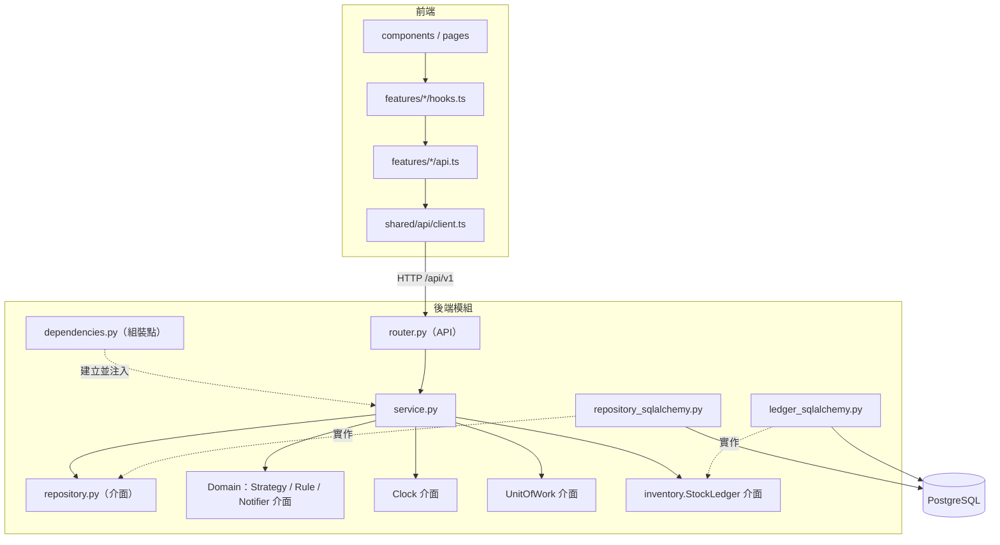
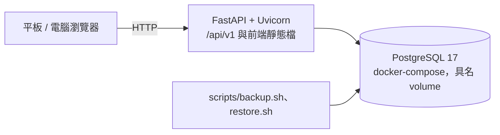
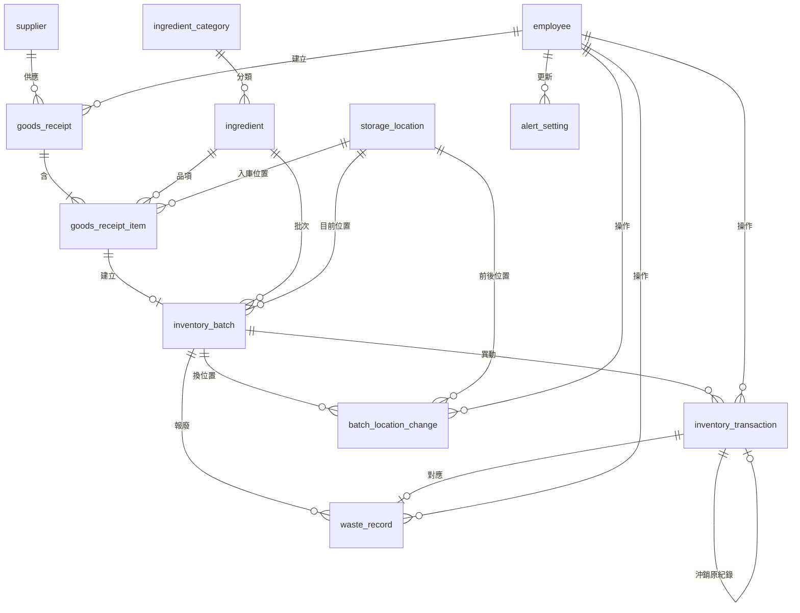

# Architecture Spine — 食序 FoodFlow

本文件規定四人平行開發時不能各做各的部分。標 `[ADOPTED]` 是小組已定案；標 `[ASSUMPTION]` 是架構師推定、小組可在實作時提出調整的細節。

## Design Paradigm

**分層架構＋Repository（課程設計層次 4）**。後端依八大功能切成模組，每個模組內分層；前端依相同功能切 feature。

| 層 | 位置 | 職責 | 不可包含 |
| --- | --- | --- | --- |
| API（Controller） | `modules/<m>/router.py`、`schemas.py` | 驗證輸入格式、驗證權限、呼叫 Service、轉成回應 | 商業規則、SQL、交易 |
| Service | `modules/<m>/service.py` | 商業規則、交易邊界、協調 Repository 與 Domain | HTTP、SQL、`Session`、`new` 具體實作 |
| Repository 介面 | `modules/<m>/repository.py` | 以業務語言定義資料存取（ABC） | 實作細節 |
| Repository 實作 | `modules/<m>/repository_sqlalchemy.py` | SQLAlchemy 查詢、列鎖 | 商業判斷、`commit` |
| StockLedger | `modules/inventory/ledger.py`（ABC）、`ledger_sqlalchemy.py`（實作） | 庫存寫入的唯一入口（AD-5、AD-20） | 領用、報廢等各功能的商業判斷 |
| Domain | `app/domain/`、`modules/<m>/strategies/`、`rules/`、`notifiers/` | 純邏輯：Strategy、Factory、效期與低庫存判定 | 資料庫、HTTP、讀取系統時間 |
| 組裝點 | `core/dependencies.py`、`modules/<m>/dependencies.py` | 唯一可建立具體類別的地方 | 商業邏輯 |

## Invariants & Rules



### AD-1 — 分層依賴方向 `[ADOPTED]`

- **Binds:** 所有後端模組；NFR-08
- **Prevents:** 把商業規則寫進 Controller、Service 直接操作 SQL。
- **Rule:** 依賴方向只能依上圖。`router.py` 不可 import Repository 或 `sqlalchemy`；`service.py` 不可 import `fastapi` 或 `sqlalchemy`；Domain 不可 import `app.db`、`fastapi`、`sqlalchemy`。以 `import-linter` 的 forbidden contract 在 CI 檢查，設定 `include_external_packages = true`、`allow_indirect_imports = true`。

### AD-2 — 建構子注入 `[ADOPTED]`

- **Binds:** 所有 Service、`StockLedger`、Strategy、Notifier、Clock
- **Prevents:** Service 自己 `new` 實作，導致測試無法替換、換實作要改 Service。
- **Rule:** Service 的相依一律是建構子參數，型別為介面。具體類別只在組裝點建立，以 FastAPI `Depends` 組裝。`core/dependencies.py` 是 `get_session`、`get_clock`、`get_uow` 的唯一定義，模組不可另寫一份；不可使用 `Depends(..., use_cache=False)`。每個 `modules/<m>/dependencies.py` 為其中每個 Service 提供純函式 `build_<name>_service(session, ...)`（例如 `storage_location` 有 `build_storage_location_service` 與 `build_batch_relocation_service`），`Depends` 版本只呼叫它；CLI、整合測試與日後的排程 job 也呼叫它，不自行建立 Service。例外：`AlertRuleFactory` 可建立 `AlertRule`，因為這是它的職責。

### AD-3 — Repository 回傳實體 `[ADOPTED]`

- **Binds:** 所有 Repository、Service
- **Prevents:** 有人回傳 ORM、有人回傳 DTO；Service 或 router 觸發延遲載入。
- **Rule:** SQLAlchemy 宣告式模型集中在 `app/db/models/`，同時作為實體類別，Service 可 import 與讀取屬性，不另建映射層。庫存欄位的寫入限制見 AD-5。每個 relationship 明確寫 `lazy="raise"`（有測試走訪所有 mapper 檢查），需要的關聯由 Repository 明確以 `selectinload` 載入；Service 回傳實體時，router 需要的關聯必須已載入。Session 設 `expire_on_commit=False`，不可關閉 autoflush。傳入 Strategy 與 AlertRule 的資料一律是不可變 dataclass（`BatchCandidate`、`AlertContext`），不傳 ORM 物件。Pydantic schema 只存在於 API 層。

**已知取捨（設計層次 4）：** 領域物件綁定 ORM，Service 因此間接依賴 SQLAlchemy，沒有達到領域層完全獨立。原因：四人要在期中前完成 12 張表與八大功能，另建映射層等於每張表多寫一套類別與轉換，也多一處出錯的地方。代價由三點控制：Service 不可直接 import `sqlalchemy`（AD-1）、`lazy="raise"` 防止隱性查詢、Strategy 與 AlertRule 使用純 dataclass。換 SQL 資料庫時不受影響；換非 SQL 資料庫時要改寫 `app/db/models/`（見 C4）。

### AD-4 — 資料表擁有權

- **Binds:** 所有模組；12 張資料表
- **Prevents:** 同一張表有兩個寫入者、各自維護不同規則。
- **Rule:** 每張表只有下表的模組可以寫入。讀取不受限：任何模組的 Repository 都可以 `SELECT`／`JOIN` 任何表，也可使用 `app/db/queries/` 的共用唯讀查詢。模組之間不可呼叫彼此的 Service 或 Repository；唯二的跨模組相依是 `inventory.ledger.StockLedger`（寫庫存）與 `auth.dependencies` 的 `get_current_employee`、`require_admin`（身分）。

| 資料表 | 寫入者 |
| --- | --- |
| `employee` | `auth` |
| `ingredient_category`、`ingredient`、`supplier` | `master_data` |
| `storage_location` | `storage_location` |
| `goods_receipt`、`goods_receipt_item` | `goods_receipt` |
| `inventory_batch`、`inventory_transaction`、`batch_location_change` | `inventory.StockLedger` |
| `waste_record` | `waste` |
| `alert_setting` | `alerts` |

### AD-5 — 庫存只能經由 StockLedger 變動

- **Binds:** FR-05、FR-06、FR-07、FR-11、FR-15、FR-16；NFR-02、NFR-03
- **Prevents:** 進貨、領用、報廢、盤點各寫一份扣庫存，造成前後量不一致或漏寫異動。
- **Rule:** `inventory_batch.remaining_quantity`、`current_location_id` 只有 `StockLedger` 可以修改（CI 以 grep 檢查 ledger 以外不可賦值）。每次數量變動在同一交易內更新批次，並新增一筆 `inventory_transaction`（`quantity_delta`、`quantity_before`、`quantity_after`、`operation_group_id`、`operator_id`、`occurred_at`、`reason`、`is_non_fefo`）。`inventory_transaction` 只能新增，不提供更新與刪除。異動類型固定為 `RECEIPT`、`ISSUE`、`WASTE`、`ADJUSTMENT`、`REVERSAL`；`CHECK ((type = 'REVERSAL') = (reverses_transaction_id IS NOT NULL))`。`reason` 每種類型都寫入可顯示的文字。位置變更寫 `batch_location_change`，不寫數量異動。呼叫介面見 AD-20。

### AD-6 — 交易邊界在 Service `[ADOPTED]`

- **Binds:** 所有寫入操作；SRS 第 5 節第 5 點
- **Prevents:** Repository 中途 `commit` 造成半套資料；交易實作與登入查詢衝突；`async def` 等鎖時卡住整個服務。
- **Rule:** 每個會寫入的 Service 公開方法自行以 `with self._uow.transaction():` 包住全部工作。`transaction()` 不呼叫 `session.begin()`：區塊正常結束時 `commit()`，發生例外時 `rollback()`，巢狀使用時丟例外，不使用 `begin_nested`。Repository 與 `StockLedger` 只可 `flush`。`get_session` 只負責請求結束時 `close()`，同一請求共用同一 Session。後端使用同步 SQLAlchemy 與 psycopg，路由與依賴一律是 `def`，不使用 `async def`。隔離層級固定為 `READ COMMITTED`（`core/db.py` 明文設定）。

### AD-7 — 列鎖與鎖定順序 `[ADOPTED]`

- **Binds:** FR-02、FR-06、FR-07、FR-11、FR-15、FR-16；NFR-02
- **Prevents:** 超領、重複入庫、鎖定順序不同造成死結；鎖後讀到舊值而靜默寫錯庫存。
- **Rule:** 所有鎖定查詢都使用 `core/db.py` 的 `for_update(stmt)`，它固定加上 `.with_for_update().execution_options(populate_existing=True)`，不可直接寫 `with_for_update`。批次只能經由 `StockLedger.lock_*` 鎖定；多筆一律依 `id` 遞增；跨表順序固定為 `goods_receipt` → `inventory_batch`。鎖定查詢不可 `joinedload`。**處理順序固定：取得鎖 → 防重送檢查 → 其他檢查（剩餘量、效期、FEFO 基準）**，鎖不到列不算錯誤。所有判斷都以鎖後的資料為準。領用一次只處理單一食材 `[ASSUMPTION]`，鎖定該食材所有 `remaining_quantity > 0` 的批次。餘量不足時回 `409 INSUFFICIENT_STOCK`，不自動改分配其他批次。`goods_receipt` 與明細的所有寫入（含編輯草稿）都先鎖單頭。任何會讓有效管理者變少的操作（停用、降權），以及建立第一位管理者，先以 `AuthRepository.lock_all()` 鎖定**全部員工**（依 `id` 遞增，`for_update`）後再計數，結果為 0 時回 `409 STATE_CONFLICT`。鎖全部員工而不只鎖有效管理者，是因為還沒有管理者時鎖不到任何列。**已知取捨：** 一般的 `FOR UPDATE` 會擋住其他交易寫入 `operator_id` 外鍵時的 `KEY SHARE` 檢查，管理者調整帳號的交易期間，其他人的領用、報廢會短暫等待（不會死結，因為帳號交易不碰批次）；若 NFR-07 測出影響，改用 `for_update(..., key_share=True)`（`FOR NO KEY UPDATE`）即可，帳號操作不改主鍵。`key_share=True` 目前只用於換位置時鎖目標位置，避免 A→B、B→A 對向換位置死結。

### AD-8 — 防重送 `[ADOPTED，領用為擴充]`

- **Binds:** FR-06、FR-07、FR-11、FR-15、FR-16；SRS 第 5 節第 5 點；NFR-02
- **Prevents:** 重按或網路重試造成重複入庫或重複扣料；每個模組各發明一種機制。
- **Rule:** 依操作分三種，不可混用。`inventory_transaction.operation_group_id` 為 `UUID NOT NULL`，加唯一鍵 `(operation_group_id, batch_id)`。

| 操作 | 重送防護 | `operation_group_id` 來源 | 重送結果 |
| --- | --- | --- | --- |
| 確認入庫、進貨沖銷 | 狀態機 `DRAFT → CONFIRMED → REVERSED`；鎖單頭後檢查狀態；唯一鍵 `inventory_batch.source_item_id` 作為最後防線 | Service 每次產生新的 `uuid4()`；沖銷不沿用原值，以 `reverses_transaction_id` 連回 | 已是目標狀態時，回 200 與單據目前狀態 |
| 領用、報廢 | 必填標頭 `Idempotency-Key`（UUID）；取得鎖後以 `find_operation(key, type)` 查詢 | `Idempotency-Key` | 已存在且 `{batch_id: quantity}` 相同時，回 200 與原結果；不同時回 `409 DUPLICATE` |
| 盤點調整 | 請求必帶預覽時的 `expected_quantity` 與 `expected_transaction_id`（該批次最後一筆異動的 `id`，無異動為 `null`），取得鎖後兩者都比對，因此數量改動後又改回同值的情況也會攔下 | Service 產生新的 `uuid4()` | 任一項不符時回 `409 STALE_QUANTITY`，`details` 帶 `current_quantity` 與 `current_transaction_id`，要求重新預覽核對 |

重放與首次回應走同一個方法，從已持久化的異動重建，數量取 `quantity_after`，不取批次目前值；寫入端點首次與重放都回 200。領用與盤點請求中同一批次重複時回 422。確認入庫時在鎖內重新驗證必填欄位、日期規則，以及食材、供應商、位置的啟用狀態（草稿階段到期日、數量、位置可為空，A4）。沖銷條件固定為：該單所有批次都不存在 `type <> 'RECEIPT'` 的異動（在鎖內查詢）；位置變更不阻擋沖銷。來源單據為 `REVERSED` 的批次不可盤點或換位置，回 `422 RULE_VIOLATION`；批次查詢回傳 `source_status`。

前端用 `useIdempotencyKey()`（回傳 `{key, rotate}`，以 `uuid` 套件產生，因為平板以 http 連線時 `crypto.randomUUID` 不可用）。每個表單實例一把 key，每次開啟一鍵報廢的確認對話框也是一把；成功後或內容變更時才 `rotate`。報廢 API 只收明確數量，不提供「全部」語意。

### AD-9 — 數量與金額

- **Binds:** 所有含數量與金額的欄位、API、前端
- **Prevents:** 浮點誤差；靜默截斷；回應格式不一；報廢金額與統計算法不一致。
- **Rule:** 數量一律 `NUMERIC(12,3)` `[ADOPTED]`，批次剩餘量另加 `CHECK (remaining_quantity >= 0)`。單價 `NUMERIC(12,2)`，損失金額 `NUMERIC(14,2)`，以 `ROUND_HALF_UP` 四捨五入。Python 一律 `Decimal`，不可出現 `float`。`core/types.py` 定義 `PositiveQuantity`、`NonNegativeQuantity`、`SignedQuantity`、`Money`：輸入只接受符合正規式的字串（整數最多 9 位、小數最多 3 位），JSON 數字、`"1e2"`、四位小數都回 422；輸出固定三位小數（`"12.500"`）；以 `WithJsonSchema` 宣告為 string。前端視為字串，不做數量運算，差額、缺口與是否非 FEFO 都由後端回傳。損失金額只在報廢時計算並寫入 `waste_record`，單價為空時存 `NULL`。

### AD-10 — 時間只來自 Clock `[ADOPTED]`

- **Binds:** 所有與日期相關的邏輯；SRS 第 5 節第 2、7 點；SM-3
- **Prevents:** 無法測試跨日；UTC 與台北日期差異造成邊界錯誤；同次操作的時間不一致。
- **Rule:** `Clock` 介面提供 `now()`（含時區）與 `today()`（Asia/Taipei 當日）。實作為 `SystemClock` 與 `FixedClock`。除 `SystemClock` 外，程式與 SQL 不可使用 `datetime.now()`、`date.today()`、`func.now()`、`CURRENT_DATE`；查詢需要今天時由 Service 傳入參數。同次操作只取一次 `clock.now()`，放入 `StockOp.occurred_at`，並寫入相關的 `goods_receipt.confirmed_at`、`waste_record.occurred_at`。`TIMESTAMPTZ` 存 UTC，API 回 ISO-8601 含時區；到期日為 `DATE`。統計區間以 `core/clock.py` 的 `taipei_day_range` 轉成半開區間。設定 `APP_FIXED_NOW` 且 `APP_ENV` 不是 `production` 時，`get_clock` 回傳 `FixedClock`，供驗收與 demo 跨日。清單排序以 `id` 作為次要鍵。

### AD-11 — 效期狀態只有一個來源

- **Binds:** FR-08、FR-09、FR-10、FR-12、FR-14
- **Prevents:** 查詢、領用、預警對「過期」判定不同；前端自行計算剩餘天數。
- **Rule:** `app/domain/expiry.py` 的 `classify_expiry(expiry_date, today, warning_days)` 是唯一定義，回傳 `EXPIRED`、`EXPIRES_TODAY`、`EXPIRING_SOON`、`NORMAL`；`is_available(expiry_date, today)` 定義 `D ≥ 0`。需要在 SQL 篩選時，Repository 以傳入的 `today`、`warning_days` 使用相同條件，並以對照測試比對兩邊結果。前端只顯示後端回傳的狀態與剩餘天數。

### AD-12 — 批次挑選 Strategy `[ADOPTED]`

- **Binds:** FR-10、FR-11
- **Prevents:** FEFO 邏輯散落在 Service；建議與確認時的算法不一致；前端自行判定非 FEFO。
- **Rule:** `BatchSelectionStrategy.select(candidates, request: SelectionRequest) -> list[Allocation]`，`SelectionRequest(total_quantity, lines=None)`。實作 `FefoStrategy`（到期日、進貨日、批號排序）與 `ManualStrategy`（驗證員工選的批次）。Strategy 只接收已過濾的 `BatchCandidate`，不查資料庫、不讀時間。`IssueService` 注入兩者。`POST /issues/suggestions` 不上鎖，用預設策略產生建議，並可接受 `lines` 回傳每行 `is_non_fefo`，前端依此顯示原因欄位。`POST /issues` 一律用 `ManualStrategy` 驗證送出的明細，並在鎖內用預設策略重算基準：某明細數量超過基準分配到該批次的數量，即為非 FEFO，該筆 `is_non_fefo = true`，`reason` 必填，否則回 `422 RULE_VIOLATION`（`fields` 指向 `lines.N.reason`）。同到期日但未選基準批次也算非 FEFO（依 FR-10）。`IssueService` 在過濾前區分錯誤：批次不存在或屬於其他食材回 404，過期回 `422 RULE_VIOLATION`，超過剩餘量回 `409 INSUFFICIENT_STOCK`。回應固定為 `{operation_group_id, lines: [{transaction_id, batch_id, batch_number, quantity, quantity_after, is_non_fefo, reason}]}`。

### AD-13 — 預警規則 Strategy＋Factory，不儲存預警 `[ADOPTED]`

- **Binds:** FR-12、FR-13、FR-14；NFR-08
- **Prevents:** 新增規則要改既有規則；預警存表後與庫存不同步；批次與低庫存預警形狀不一致。
- **Rule:** `AlertRule.evaluate(context: AlertContext) -> list[Alert]`。首版實作 `ExpiredRule`、`ExpiringTodayRule`、`ExpiringSoonRule`、`LowStockRule`；`AlertRuleFactory.create(setting)` 依預警設定組合。規則只讀 `AlertContext`（今天、預警天數、批次與食材量的快照）。**預警在每次查詢時即時計算，不寫入資料表**，也沒有背景工作。排序以各規則宣告的 `rank` 為準（過期 → 今日到期 → 即期 → 低庫存），前端不自行排序；同一 rank 內依到期日、食材 `id`。回應帶 `generated_at`。動作由規則宣告，新增規則不動 Notifier：

```python
@dataclass(frozen=True)
class AlertAction:
    type: Literal["ISSUE", "WASTE", "CREATE_GOODS_RECEIPT"]
    ingredient_id: int
    batch_id: int | None = None
    quantity: Decimal | None = None      # 一鍵報廢帶快照剩餘量
    reason_code: str | None = None       # 一鍵報廢帶 EXPIRED

@dataclass(frozen=True)
class Alert:
    kind: AlertKind                      # 定義於 alerts/rules/base.py
    rank: int
    ingredient_id: int
    ingredient_name: str
    unit: str
    batch: BatchAlertInfo | None         # 批號、位置、數量、到期日、剩餘天數
    stock: StockAlertInfo | None         # 可用量、安全量、缺口量
    actions: tuple[AlertAction, ...]     # 過期批次不含 ISSUE
```

`alert_setting` 是單列：Migration 建立預設值，讀取固定取 `id` 最小者。

### AD-14 — 通知 Adapter `[ADOPTED]`

- **Binds:** FR-14；SRS 第 7.2 節外部通知
- **Prevents:** 預警邏輯綁定通知管道；查詢頁面時誤發外部通知。
- **Rule:** `Notifier.notify(alerts) -> NotificationResult(delivered, items)`。期中只有 `InAppNotifier`，它的投遞管道就是 API 回應，回傳 `items=alerts`；外部 Notifier 回傳 `items=()`。`AlertService.evaluate()` 只計算；`list_alerts()` 呼叫 `evaluate()` 再交給注入的站內 Notifier。外部 Notifier 不可在 GET 請求中觸發，只能由獨立的 job 呼叫 `evaluate()` 後觸發（見 C3）。`[ASSUMPTION：InAppNotifier 語意]`

### AD-15 — 認證與權限 `[ADOPTED]`

- **Binds:** FR-01、FR-02；NFR-04；所有 API
- **Prevents:** 登出或停用後舊憑證仍可用；路由漏掛驗證；各模組各自檢查權限。
- **Rule:** 登入後發 JWT，放在 `httpOnly`、`SameSite=Lax` cookie，含 `sub=str(employee.id)`、`token_version`、`exp`（12 小時，可設定）。`exp` 由 `clock.now()` 計算；解碼時設 `options={"verify_exp": False, "verify_iat": False}`，再由 `get_current_employee` 以注入的 Clock 比對，所以 `APP_FIXED_NOW` 下仍可登入。Cookie 用相對的 `max_age`，`Secure` 由設定開啟（區網 http demo 時關閉）。`JWT_SECRET` 至少 32 bytes，未設定時拒絕啟動。每個請求由 `get_current_employee` 查資料庫，確認帳號啟用且版本相符；登出、停用與重設密碼時遞增 `token_version`。`/api/v1` 主路由預設掛 `get_current_employee`，只有登入端點在明確的公開路由，並以測試列舉 `app.routes` 比對。權限在路由層以 `require_admin` 宣告，對應 SRS 第 4.1 節；Service 接收 `operator_id: int`。`GET /auth/me` 提供目前員工與角色，前端以 `useCurrentEmployee` 取得；前端的角色判斷只影響顯示。密碼雜湊用 `pwdlib` Argon2。第一位管理者由 `python -m app.cli create-admin` 建立，repo 內不放預設密碼。

### AD-16 — API 契約與錯誤格式

- **Binds:** 所有 API、前端 `client.ts`
- **Prevents:** 前後端欄位不合；每個模組錯誤格式不同，無法做 NFR-05 的欄位提示；併發最後防線變成 500。
- **Rule:** 路徑前綴 `/api/v1`，資源為複數 kebab-case；JSON 欄位為 snake_case。清單回 `{items, total, page, page_size}`。列舉值定義於 `core/enums.py`，經 OpenAPI 匯出。Service 丟 `DomainError(code, message, details, fields)`，由單一 exception handler 轉成 HTTP；Pydantic 422 轉成同一格式，只取 `loc` 與 `msg`，依 `type` 對應繁體中文訊息。`fields[].field` 用點號路徑（`lines.0.quantity`），移除 `body` 前綴。`details` 內的 `Decimal` 一律先轉字串。未預期例外回 `500 INTERNAL_ERROR`，不回傳內部細節。Repository 實作以 `core/errors.py` 的 `flush_or_raise` 把 `IntegrityError` 依 constraint 名稱轉成 `DomainError`。`ErrorResponse` 以 `APIRouter(responses=...)` 宣告，取代預設的 `HTTPValidationError`。

```json
{"error": {"code": "INSUFFICIENT_STOCK", "message": "可用量不足", "details": {"batch_id": 1, "remaining_quantity": "2.000", "available_quantity": "7.000"}, "fields": [{"field": "lines.0.quantity", "message": "..."}]}}
```

| HTTP | code | 固定的 `details` |
| --- | --- | --- |
| 401 | `UNAUTHENTICATED`、`INVALID_CREDENTIALS` | |
| 403 | `FORBIDDEN` | |
| 404 | `NOT_FOUND` | |
| 409 | `INSUFFICIENT_STOCK` | `{batch_id, remaining_quantity, available_quantity}`（未知者為 `null`） |
| 409 | `STALE_QUANTITY` | `{batch_id, current_quantity, current_transaction_id}` |
| 409 | `STATE_CONFLICT`、`DUPLICATE`、`REFERENCED` | |
| 422 | `VALIDATION_ERROR`、`RULE_VIOLATION` | |
| 500 | `INTERNAL_ERROR` | |

前端型別由 OpenAPI 產生到 `shared/api/schema.d.ts`，不手寫。`backend/scripts/export_openapi.py` 不連資料庫輸出 `app.openapi()`，`npm run gen:api` 產生型別。產生檔要提交；衝突時不手動合併，rebase 後重新產生；CI 以 `git diff --exit-code` 檢查。

### AD-17 — 前端資料存取 `[ADOPTED]`

- **Binds:** 所有前端 feature
- **Prevents:** 元件直接 `fetch`；同一資料有多種請求寫法。
- **Rule:** 元件與頁面只能使用 `features/<f>/hooks.ts`。`hooks.ts` 呼叫同 feature 的 `api.ts`，`api.ts` 只透過 `shared/api/client.ts` 發請求。元件不可 import `api.ts`、`client.ts`、`axios`；feature 之間不可 import 彼此的 `api.ts`，要共用時用對方匯出的 hook。以 ESLint `no-restricted-imports` 加 `no-restricted-globals`（`fetch`，僅 `client.ts` 例外）檢查。伺服器資料只放 TanStack Query。React Router 只管路由，不使用 `loader`／`action`，且只安裝 `react-router`，不安裝 `react-router-dom`。`client.ts` 統一處理 401（導回登入頁）與錯誤格式。

### AD-18 — 查詢快取失效

- **Binds:** FR-13、FR-14；所有會影響庫存顯示的 mutation
- **Prevents:** 領用後首頁預警仍是舊資料；改預警天數或安全庫存量後畫面不更新。
- **Rule:** query key 以 feature 名稱開頭，全部集中在 `shared/api/queryKeys.ts`。以下 mutation 成功後一律呼叫 `invalidateStockQueries()`（失效 `storage-locations`、`inventory`、`alerts`、`issue`、`goods-receipt`、`waste`、`stocktake`、`reports`；位置清單與摘要含批次數與效期統計，所以也要失效）：數量異動、換位置、進貨確認與沖銷、食材與分類變更、預警設定變更。`alerts`、`inventory` 的 `staleTime` 固定為 0。未確認成功不可顯示完成（NFR-05）。

### AD-19 — Schema 只由 Alembic 變更

- **Binds:** 所有資料表
- **Prevents:** 每人本機 schema 不同；migration 分岔；綁死特定資料庫。
- **Rule:** 不可使用 `create_all`。所有 schema 變更都是 Alembic migration，且只能有一個 head（CI 檢查）；PR 合併前若 main 已有新 migration，須調整 `down_revision`。Migration 手動執行 `alembic upgrade head`，應用程式啟動時不自動執行。metadata 使用固定命名規則命名 constraint。Migration 建立 `alert_setting` 預設列（預警天數 3，A7）。資料表用單數 snake_case，主鍵由共用 mixin 提供 `BigInteger, Identity()`。模型只用 SQLAlchemy 通用型別（`Uuid`、`DateTime(timezone=True)`、`Numeric`）。

### AD-20 — StockLedger 介面

- **Binds:** `goods_receipt`、`issue`、`waste`、`stocktake`、`storage_location`；AD-5、AD-7
- **Prevents:** 四個模組對誰上鎖、數量正負、回傳值的理解不同，造成沒有上鎖或領用變加庫存。
- **Rule:** 介面如下，由 Ken 在骨架提供實作與 `tests/fakes/fake_stock_ledger.py`。`quantity` 一律大於 0，正負由 Ledger 決定；鎖定方法是批次唯一的鎖定入口；實例記住本次鎖過的 id，`deduct`、`adjust`、`reverse`、`move` 遇到未鎖定的批次直接丟例外；結果小於 0 時丟 `INSUFFICIENT_STOCK`。Ledger 不注入 Clock，時間由 `StockOp` 傳入。

```python
@dataclass(frozen=True)
class StockOp:                           # 同次操作共用
    operation_group_id: UUID
    operator_id: int
    occurred_at: datetime                # Service 以 clock.now() 取一次
    reason: str | None = None

class StockLedger(ABC):
    def lock_batches(self, batch_ids: Sequence[int]) -> list[InventoryBatch]: ...
    def lock_ingredient_batches(self, ingredient_id: int) -> list[InventoryBatch]: ...  # remaining > 0
    def find_operation(self, group_id: UUID, tx_type: TransactionType) -> list[InventoryTransaction]: ...
    def receive(self, item: GoodsReceiptItem, op: StockOp) -> InventoryTransaction: ...   # 建批次＋RECEIPT
    def deduct(self, batch, quantity, tx_type, op, is_non_fefo=False) -> InventoryTransaction: ...  # ISSUE | WASTE
    def adjust(self, batch, actual_quantity, op) -> InventoryTransaction | None: ...      # 無差額回 None
    def reverse(self, original: InventoryTransaction, op: StockOp) -> InventoryTransaction: ...
    def move(self, batch, to_location_id, op) -> BatchLocationChange | None: ...          # 同位置回 None
```

### AD-21 — 庫存量與低庫存只有一個來源

- **Binds:** FR-08、FR-10、FR-11、FR-13、FR-14；SRS 第 5 節第 4 點；SM-3
- **Prevents:** 首頁與庫存總覽的低庫存不一致；從未進貨的食材漏發提醒；位置篩選造成誤報。
- **Rule:** `app/domain/stock.py` 的 `is_low_stock(available, safety)`（`safety > 0 and available <= safety`）與 `shortfall(available, safety)` 是唯一定義。`app/db/queries/stock_levels.py` 的 `stock_level_stmt(today, location_id=None)` 從 `ingredient` LEFT JOIN 批次，回傳實體量、可用量、過期量，`inventory` 與 `alerts` 都使用它。**低庫存一律以全店可用量判定，不受位置篩選影響。** 位置篩選只影響顯示的數量；有位置篩選時，低庫存項目只在該食材有 `remaining_quantity > 0` 的批次位於該位置才顯示。食材符合某效期狀態篩選，等於至少有一個剩餘量大於 0 的批次屬於該狀態。停用食材不產生低庫存提醒，但其批次仍產生效期提醒 `[ADOPTED]`。以對照測試涵蓋無批次、全過期、等於安全量、安全量為 0。

### AD-22 — 統計算法

- **Binds:** FR-17、FR-18；SRS 第 5 節第 7 點
- **Prevents:** 報表公式不平衡；用進貨日期而非確認時間；金額與數量來源分歧。
- **Rule:** 統計的**數量**只來自 `inventory_transaction`，依 `occurred_at` 落入半開區間，不用進貨日期。期初量是 `occurred_at < 起日 00:00` 的 `SUM(quantity_delta)`，期末量是 `occurred_at < 迄日次日 00:00` 的合計。歸類規則為 `COALESCE(原紀錄.type, type)`：`REVERSAL` 歸入原紀錄的類型，因此跨期沖銷讓當期淨進貨為負；淨領用與淨報廢取負號以符合公式減項；調整淨額為 `ADJUSTMENT` 合計。期間內無異動但期初不為零的食材也要列出。**金額與原因分布**來自 `waste_record`，只加總有金額的紀錄並回傳未知筆數，依 `(分組鍵, unit)` 分組，不同單位不合計。報廢分布與損失金額限管理者；期初期末統計全員可看；一般員工的報廢回應不含 `loss_amount` `[ADOPTED]`。

### AD-23 — 前端跨 feature 契約與介面規則

- **Binds:** FR-14；NFR-01、NFR-05
- **Prevents:** 預警頁連不到其他功能；狀態標示不一致；平板無法操作。
- **Rule:** 路由集中在 `app/router.tsx`，路徑常數放 `shared/routes.ts`，由它把 `AlertAction` 對應到路由與參數：`/`（預警首頁）、`/issues/new?ingredient_id=`、`/waste-records/new?batch_id=`、`/goods-receipts/new?ingredient_id=`。一鍵報廢使用 `features/waste` 匯出的 hook。效期與低庫存狀態只用 `shared/ui/StatusBadge`，同時顯示文字與顏色，對應表放 `shared/ui/statusBadgeMap.ts`。操作不放在 `Tooltip` 或 hover 中，主要操作目標至少 44px。進貨、領用、報廢與預警頁的 PR 要在 1024×768 與 1366×768 檢查。

## Consistency Conventions

| Concern | Convention |
| --- | --- |
| 實體命名 | 依 `CONTRIBUTING.md` 第 6 節，此節定稿如下；資料表為其單數 snake_case（`GoodsReceiptItem` → `goods_receipt_item`） |
| 補充命名 | 領用 `Issue`、盤點 `Stocktake`、沖銷 `Reversal`、到期日 `expiry_date`、剩餘量 `remaining_quantity`、操作群組 `operation_group_id`、非 FEFO `is_non_fefo`、操作時間 `occurred_at` |
| 類別命名 | `<Name>Service`、`<Name>Repository`（介面）、`SqlAlchemy<Name>Repository`（實作）、`<Name>Strategy`、`<Name>Rule`、`<Name>Notifier` |
| 檔案命名 | 後端模組資料夾與前端 feature 資料夾都用 snake_case，且同名（`goods_receipt`、`storage_location`）；元件 PascalCase；query key 與 API 路徑用 kebab-case |
| 單號 | 批號存欄位 `B-{source_item_id:08d}`（新增時已知）；進貨單號不存欄位，由實體 property 產生 `GR-{id:08d}`，查詢時解析回 `id` |
| 主檔刪除 | 被引用的資料只能停用（`is_active = false`），刪除時回 `409 REFERENCED` |
| 設定 | 只透過 `core/config.py`（`pydantic-settings`）讀環境變數；`.env.example` 列出全部變數 |
| 日誌 | 使用標準 `logging`；不可記錄密碼、JWT |
| 測試 | Service 單元測試用 fake Repository、`FakeStockLedger`、`FixedClock`；列鎖、併發、防重送的測試必須連真實 PostgreSQL（`foodflow_test`），含「鎖前先讀同一批次」情境 |
| 版本與鎖定檔 | 提交 `uv.lock`、`package-lock.json`；CI 用 `uv sync --locked`、`npm ci`；根目錄 `.nvmrc`（24），`backend/.python-version`（3.13），`frontend/.npmrc` 設 `engine-strict=true` |
| 用語 | UI 與文件用 SRS 名詞（領用，不是取用）；不在首版範圍的功能不出現在程式與文件 |

## Stack

查詢日期 2026-11-05（PyPI、npm registry、endoflife.date），版本相容性已由獨立審查實測。Node 24 上的 `vite build`、`vitest`，以及真實 PostgreSQL 17 上的列鎖與併發測試，已在 CI（`.github/workflows/ci.yml`）每次執行。

| Name | Version |
| --- | --- |
| Python（由 uv 管理） | 3.13 |
| FastAPI | 0.162.0 |
| Uvicorn | 0.54.0 |
| SQLAlchemy | 2.1.8 |
| Alembic | 1.20.1 |
| Pydantic | 2.14.2 |
| pydantic-settings | 2.16.2 |
| psycopg[binary] | 3.3.8 |
| PyJWT | 2.15.1 |
| pwdlib[argon2] | 0.3.1 |
| tzdata | 2026.6 |
| pytest | 9.2.0 |
| httpx2 | 2.16.0 |
| Ruff | 0.17.3 |
| import-linter | 2.15 |
| PostgreSQL（`postgres:17-alpine`） | 17 |
| Node.js | 24 LTS |
| React、react-dom | 19.3.1 |
| @types/react、@types/react-dom | 19.3.0 |
| TypeScript | 5.9.3 |
| Vite | 8.3.5 |
| @vitejs/plugin-react | 6.2.1 |
| @mantine/core、@mantine/hooks、@mantine/form、@mantine/dates | 9.7.5 |
| dayjs | 1.11.23 |
| postcss | 8.5.32 |
| postcss-preset-mantine | 1.18.0 |
| postcss-simple-vars | 7.0.1 |
| @tanstack/react-query | 5.105.3 |
| react-router | 8.5.1 |
| uuid | 14.0.3 |
| openapi-typescript | 7.13.0 |
| Vitest | 5.1.0 |
| ESLint | 10.14.0 |
| @eslint/js | 10.0.1 |
| typescript-eslint | 8.72.1 |

- TypeScript 不用最新的 7.x，因為 `openapi-typescript` 與 `typescript-eslint` 都不支援。安裝時要明確指定版本，否則 npm 會裝到 7。
- 全組需使用 Node 24：`react-router` 8 要求 ≥ 22.22，`vitest` 5 不支援 20。在 Node 20.17 上 `vite build` 會出現誤導的 `Cannot find native binding` 錯誤，原因是 Node 版本，不要反覆重裝。
- 不要安裝 `eslint-plugin-react`（不支援 ESLint 10），不要執行 `npm audit fix --force`。`tsconfig` 使用 `skipLibCheck: true`。

## Structural Seed

### 系統與部署



| 環境 | 方式 |
| --- | --- |
| 開發 | `docker compose up db`；`uvicorn` 與 Vite dev server（`server.host: true`，proxy 轉送 `/api`，維持同源，不開 CORS） |
| 測試 | 同一容器的 `foodflow_test`，由 `docker/initdb/01-create-test-db.sql` 建立（只在資料目錄為空時執行；既有環境要手動 `CREATE DATABASE`） |
| CI | GitHub Actions：PostgreSQL service、Ruff、import-linter、pytest、`tsc`、ESLint、Alembic 單一 head、`schema.d.ts` 差異檢查 |
| Demo | 本機或區網。FastAPI 掛載 `frontend/dist` 並提供 SPA fallback，同源、單一 port，`Secure` cookie 關閉 |

- **初始化順序：** `docker compose up -d db` → `alembic upgrade head` → `python -m app.cli create-admin` →（demo）`python -m app.cli seed-demo` 建立 SRS 第 9 節場景，`APP_ENV=production` 時拒絕執行。
- **備份與還原（NFR-06，Story 9.1）：** `scripts/backup.sh` 在容器內執行 `pg_dump -Fc`，以 `docker compose cp` 取出到 `backups/`，同時寫一份同名 `.counts`（批次筆數、異動筆數、Alembic 版本）。`scripts/restore.sh` 的順序為：確認目前 schema 版本與備份相同、確認後端已停（資料庫沒有其他連線）、`pg_restore --clean --if-exists --no-owner --single-transaction`（失敗時整筆回復）、`python -m app.cli verify-stock`、與 `.counts` 比對批次與異動筆數，不一致時以非零狀態結束。Windows 在 Git Bash 執行。
- **庫存核對（NFR-03、SM-2）：** `python -m app.cli verify-stock` 檢查每批次 `remaining_quantity == SUM(quantity_delta)`、最新一筆 `quantity_after == remaining_quantity`、每筆 `WASTE` 異動都有 `waste_record`；有差異時以非零狀態結束，併發整合測試結尾也執行。

### 原始碼結構

```text
foodflow/
  docker-compose.yml
  docker/initdb/01-create-test-db.sql
  .env.example
  .nvmrc
  scripts/                       # backup.sh、restore.sh、ai-evidence/、ship.mjs
  backend/
    pyproject.toml  uv.lock  .python-version
    alembic/versions/
    scripts/export_openapi.py
    app/
      main.py                    # 建立 app、掛 router、exception handler、靜態檔
      cli.py                     # create-admin、seed-demo、verify-stock
      core/                      # config、db、uow、clock、errors、types、enums、dependencies、idempotency
      db/models/                 # 12 個 ORM 模型（AD-3）
      db/queries/stock_levels.py # 共用唯讀查詢（AD-21）
      domain/                    # expiry.py、stock.py、units.py
      modules/
        <m>/                     # router、schemas、service、repository、repository_sqlalchemy、dependencies（errors 選用）
        health/                  # GET /health，不在 /api/v1 之下、不需登入
        inventory/               # ledger.py、ledger_sqlalchemy.py（AD-20）
        issue/strategies/        # base、fefo_strategy、manual_strategy
        alerts/rules/            # base、expired_rule、expiring_today_rule、expiring_soon_rule、low_stock_rule
        alerts/rule_factory.py   # AlertRuleFactory
        alerts/notifiers/        # base、in_app_notifier
    tests/
      unit/  integration/  fakes/
  frontend/
    package.json  package-lock.json  .npmrc  postcss.config.cjs
    src/
      app/                       # router.tsx、providers、layout、theme.ts、theme.css
      shared/api/                # client.ts、queryKeys.ts、schema.d.ts
      shared/hooks/              # useIdempotencyKey
      shared/routes.ts
      shared/ui/                 # PageHeader、Toolbar、DataTable、EmptyState、FormModal、StatusBadge、
                                 # statusBadgeMap.ts、Quantity、ActiveBadge、CodeTag、StorageTypeIcon、icons
      features/<f>/              # api.ts、hooks.ts、components/、pages/（資料夾名稱同後端模組）
```

### 資料表關聯



`employee` 需有 `token_version`（AD-15）。

### 骨架交付清單（11/6，Ken）

其他三人當天開工需要這些，缺一項就會各做一份：

- 12 張表的 Alembic migration、`app/db/models/`、`stock_levels` 查詢
- `core/` 全部：`for_update`、`UnitOfWork`、`Clock`、`DomainError`、`flush_or_raise`、`Quantity` 系列型別、`core/enums.py`、`core/dependencies.py`
- `StockLedger` 介面、實作與 `FakeStockLedger`
- `get_current_employee`、`require_admin` 的 stub（回傳 `Employee`，謝文佳 11/7 換成實作）
- 前端：`client.ts`、`queryKeys.ts`（列全部 feature）、`invalidateStockQueries`、`useIdempotencyKey`、`shared/routes.ts`、`StatusBadge`、ESLint 規則
- CI、`.nvmrc`、`.python-version`、鎖定檔、`.env.example`、`docker/initdb/`
- 一個帶登入 cookie 的寫入整合測試，以獨立 Session 確認資料確實落地

## Capability → Architecture Map

| 需求 | 後端模組 ／ 路由 | 負責人 | 依循 |
| --- | --- | --- | --- |
| FR-01、FR-02 | `auth` ／ `/auth`、`/employees` | 謝文佳 | AD-7、AD-15 |
| FR-03、FR-04 | `master_data` ／ `/ingredient-categories`、`/ingredients`、`/suppliers` | 謝文佳 | AD-4 |
| FR-05 | `storage_location` ／ `/storage-locations`、`POST /inventory-batches/{id}/location` | Ken | AD-4、AD-5、AD-20 |
| FR-06、FR-07 | `goods_receipt` ／ `/goods-receipts` | ChiaJungTien | AD-5～AD-8、AD-20 |
| FR-08、FR-09 | `inventory` ／ `/inventory` | ChiaJungTien（`StockLedger` 由 Ken 負責） | AD-5、AD-11、AD-21 |
| FR-10、FR-11 | `issue` ／ `/issues`、`/issues/suggestions` | Ken | AD-5～AD-8、AD-12、AD-20 |
| FR-12、FR-13、FR-14 | `alerts` ／ `/alerts`、`/alert-settings` | 謝文佳 | AD-10、AD-11、AD-13、AD-14、AD-21、AD-23 |
| FR-15 | `waste` ／ `/waste-records` | 郭明儒 | AD-5、AD-8、AD-9、AD-20 |
| FR-16 | `stocktake` ／ `/stocktakes`、`/stocktakes/preview` | 郭明儒 | AD-5、AD-7、AD-8、AD-20 |
| FR-17、FR-18 | `reports` ／ `/inventory-transactions`、`/reports` | 郭明儒 | AD-4、AD-9、AD-10、AD-22 |

| 跨功能需求 | 落實方式 | 負責人 |
| --- | --- | --- |
| NFR-01 | AD-23、`StatusBadge` | 各 feature；`StatusBadge` 由 Ken 提供 `[ASSUMPTION]` |
| NFR-02、NFR-03 | AD-5～AD-8、AD-20、`verify-stock` | Ken `[ASSUMPTION]` |
| NFR-04 | AD-15 | 謝文佳 |
| NFR-05 | AD-16、AD-18 | 各 feature |
| NFR-06 | 備份與還原腳本（Story 9.1） | Ken |
| NFR-07 | 期末壓力測試（見 Deferred） | 待指派 |
| NFR-08 | AD-1、AD-2、AD-12～AD-14 | 全組 |

## 變更檢驗表（C1～C5）

路徑皆相對於 repo 根目錄；`app/` 指 `backend/app/`。

| 情境 | 新增 | 修改 | 不用改 |
| --- | --- | --- | --- |
| **C1 新增預警規則** | `app/modules/alerts/rules/<new>_rule.py`；`backend/tests/unit/test_<new>_rule.py` | `alerts/rule_factory.py`（註冊一行）；`alerts/rules/base.py`（`AlertKind` 加一個值）；`frontend/src/shared/ui/statusBadgeMap.ts`（顯示文字與顏色）；重新產生 `schema.d.ts` | 既有四個規則、`AlertService`、`router.py`、`Notifier` |
| **C2 換挑批次規則**（例如改 FIFO） | `app/modules/issue/strategies/<new>_strategy.py`；對應單元測試 | `issue/dependencies.py`（換注入的預設策略一行） | `IssueService`、`ManualStrategy`、`router.py`、`StockLedger`、Repository、前端 |
| **C3 加外部通知** | `app/modules/alerts/notifiers/<channel>_notifier.py`；`app/jobs/daily_alert_digest.py`（排程進入點，以 `build_alerts_service` 組裝後呼叫 `evaluate()`）；對應測試 | `core/config.py`、`.env.example`（通道設定）；`docker-compose.yml` 或系統排程（觸發 job）；`pyproject.toml`（若需要新套件） | 所有 `AlertRule`、`AlertRuleFactory`、`InAppNotifier`、`AlertService`、`alerts/dependencies.py`、`router.py`、前端 |
| **C4 換資料庫**（例如 MySQL） | 新資料庫的 baseline migration | `docker-compose.yml`、`docker/initdb/`、`.env.example`、`pyproject.toml`（driver）；`core/db.py`；`alembic/env.py`；`db/models/` 與 `db/queries/`（僅不相容的型別或語法）；`modules/*/repository_sqlalchemy.py`、`inventory/ledger_sqlalchemy.py`（僅不相容的查詢）；`core/db.py` 的 `for_update(key_share=True)`（`FOR NO KEY UPDATE` 為 PostgreSQL 語法）；`scripts/backup.sh`、`restore.sh`（`pg_dump`／`pg_restore` 與 `.counts` 的 SQL） | 所有 `service.py`、`router.py`、`schemas.py`、Domain、Repository 介面、`StockLedger` 介面、前端 |
| **C5 測試跨日** | `backend/tests/` 下的測試案例 | 無正式程式碼。單元測試注入 `FixedClock`；API 測試用 `app.dependency_overrides[get_clock]`（`core/dependencies.py` 的唯一定義）；手動驗收設定 `APP_FIXED_NOW` | `SystemClock`、`service.py`、`router.py`、Domain、Repository |

補充：

- **C1：** 若新規則需要 `AlertContext` 還沒有的資料，還要改 `AlertContext` 與載入它的 Repository；若預警是新形狀，還要改 `Alert`、`alerts/schemas.py`。兩種情況既有規則都不用改。
- **C2：** 換成非 FEFO 策略後，`is_non_fefo` 的實際意義變成「偏離系統建議」；欄位名稱與報表文字要另外決定是否調整。
- **C3：** 外部 Notifier 只由 job 使用，GET 路徑仍注入 `InAppNotifier`，所以不會在查詢時發送外部通知。
- **C4：** 換 SQL 資料庫時要重跑 `tests/integration`，並確認 `core/db.py` 設定 `READ COMMITTED`（MySQL 預設是 `REPEATABLE READ`，會讓 AD-7 鎖後的查詢讀到舊快照）。換成非 SQL 資料庫時，要重寫所有 `repository_sqlalchemy.py`、`ledger_sqlalchemy.py` 與 `UnitOfWork` 實作，並重新評估 AD-7 的鎖定機制，只要實體屬性維持相同，Service 就不用改。`app/db/models/` 也要改寫成不依賴 SQLAlchemy 的類別（AD-3 的已知取捨）。
- **C5：** 驗收時要包含「`APP_FIXED_NOW` 下可登入並完成一次寫入」。

## Deferred

| 項目 | 可延後的原因 ／ 重新檢視時機 |
| --- | --- |
| 交易更正、FEFO 遵循率報表、外部通知、CSV 匯出 | SRS 第 7.2 節期末延伸；資料結構已預留（`is_non_fefo`、`reverses_transaction_id`、`Notifier`） |
| 背景排程器 | 首版無背景工作；做 C3 時才選工具 |
| 對外網路部署與 HTTPS | 期中只在本機與區網 demo；對外部署前必須處理（NFR-04） |
| NFR-07 負載測試（`seed-load-test`、工具選型） | 已確認排在期末；負責人待定 |
| 其他「檢查後寫入」競態（例如停用位置） | 機率低、可人工更正；列入測試報告的已知限制 |
| 欄位細節與索引 | 由 11/6 的 migration 決定；索引依 NFR-07 測試結果調整 |
| ~~視覺設計~~ | 已完成：視覺規範為 `docs/design/DESIGN.md`，實作為 `frontend/src/app/theme.ts`；色碼只能寫在主題，`src/features/**` 由 ESLint 擋住寫死的色碼；共用元件見 `frontend/src/shared/ui/` |

## 已確認決策

小組於 2026-11-05 確認：

1. **每日預警排程：** 首版不做，預警在查詢時即時計算（AD-13）。`docs/team-tasks.md` 已同步。
2. **統計權限：** 報廢分布與損失金額只給管理者（AD-22）。SRS 第 4.1 節權限表已同步。
3. **停用食材：** 不提醒低庫存（AD-21）。
4. **NFR-07 負載測試：** 放期末，負責人待定。SRS 第 7.1 節已同步。
