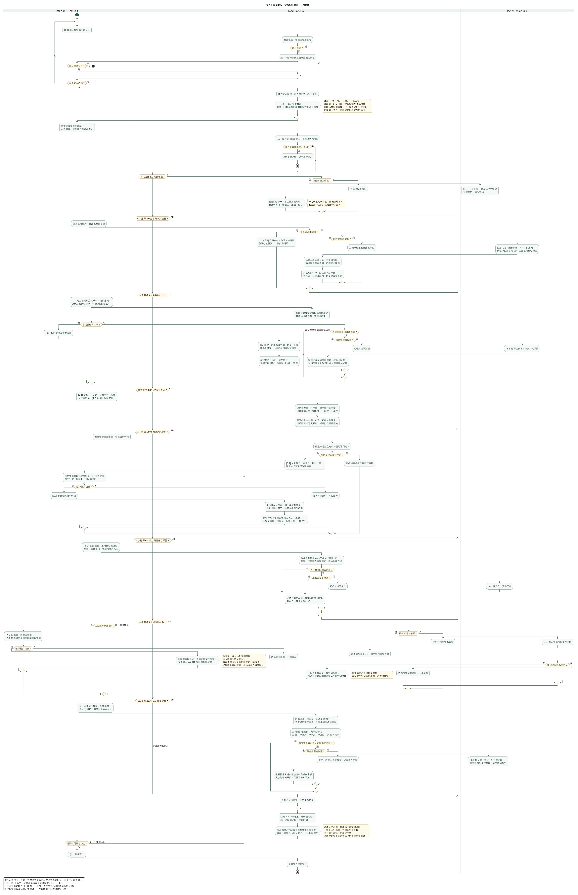
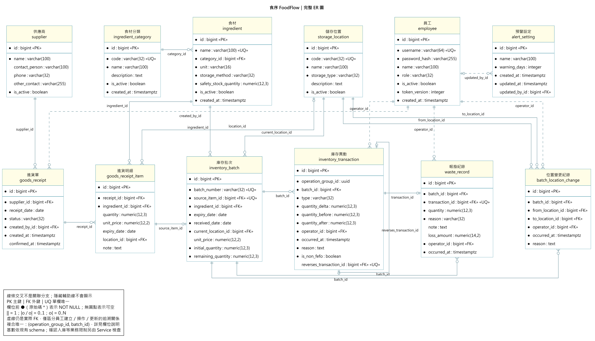
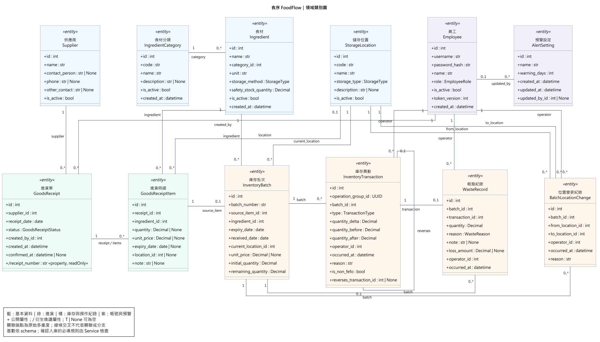

# 食序 FoodFlow｜B 軟體需求分析文件（三至五）

餐飲食材庫存與有效期限預警系統｜第 17 組

## 三、泳道圖

本系統以「登入與權限判定 → 預警首頁 → 依需求選擇作業 → 系統驗證與處理 → 回傳結果 → 繼續操作或登出」描述整體營運流程，涵蓋帳號權限、基本資料與位置、進貨批次、庫存查詢、領用、效期與低庫存預警、報廢盤點及異動統計八大模組，對應 FR-01～FR-18。

泳道分為「操作人員（共用作業）」、「FoodFlow 系統」與「管理者（專屬作業）」。操作人員包含一般員工與管理者，管理者亦可執行所有共用作業；管理者專屬泳道不代表一般營運作業須經主管審核。圖中各模組為任選分支，上下排列不表示每次都必須依序執行進貨、領用、報廢與盤點。

圖 3-1　FoodFlow 全系統泳道圖。圖中 1.1～8.3 沿用 B 文件功能清單編號。

[SVG 放大版](diagrams/b-swimlane-system-overview.svg)｜[PlantUML 原始檔](diagrams/b-swimlane-system-overview.puml)

### （一）操作人員端操作流程

1. 操作人員輸入帳號與密碼登入。系統驗證成功後，進入預警首頁，查看過期、今日到期、即期及低庫存資訊，並可依狀態或位置篩選。
2. 依實際作業需要，從導覽列或預警連結選擇進貨、庫存查詢、領用、報廢、異動查詢或期間庫存統計，不需先執行其他無關模組。
3. 收貨時選擇供應商、進貨日期及食材明細，記錄數量、可選填單價、到期日與位置。資料尚未齊全時保留草稿；核對完成後確認入庫，或查詢既有進貨及來源批次。
4. 備料時選擇食材與需求量，查看 FEFO 批次建議，核對實際拿取的批次與數量。偏離建議順序時填寫原因，再確認提交；過期及零庫存批次不得領用。
5. 發現食材無法使用時登記報廢量與原因；過期批次可選擇剩餘量全數報廢。報廢須經確認，不因食材過期而自動扣除庫存。
6. 查詢庫存總覽、批次效期、位置、來源進貨及異動紀錄；依日期區間查看期間庫存統計。完成後可繼續選擇其他功能，或登出使原登入狀態失效。

### （二）系統端處理流程

1. 接收登入請求，檢查帳號、密碼與啟用狀態；後續每次請求重新驗證登入及角色權限，拒絕未登入、帳號停用或越權操作。
2. 依最新庫存與 Asia/Taipei 當日日期計算效期及低庫存預警。過期量不計入可用量，安全庫存量為零時不提醒；頁面載入、重新整理及操作成功後更新查詢結果。
3. 接收進貨確認後，檢查單據狀態、有效主檔、至少一筆明細，以及數量、單價、到期日與位置。通過後在同一交易中建立各筆明細的唯一批次及 RECEIPT 異動；已確認單據重試時回傳既有結果。
4. 領用建議依到期日、進貨日期及批號排序，優先分配較早到期的可用批次，不足時接續下一批。提交時在鎖定後重新檢查效期、最新剩餘量與非 FEFO 原因，通過後整次扣庫存並建立 ISSUE 異動。
5. 報廢時同步扣除庫存、建立 WASTE 異動與報廢紀錄；盤點以差額建立 ADJUSTMENT；進貨沖銷新增可追溯原紀錄的 REVERSAL。整批移位另記前後位置，數量及效期不變。
6. 維持整筆交易全部成功或全部不生效，同次操作重送不得重複入庫或扣庫存；錯誤時回傳原因並保留可修正的輸入。回應中斷時應查詢既有結果或沿用同次操作重試。
7. 依權限提供歷史查詢與統計。數量異動不可直接修改或刪除，位置變更分開呈現；不同食材及單位不混加，報廢金額只加總已知單價並標示未知筆數。

### （三）管理者端操作流程

1. 維護員工帳號、角色與啟用狀態，必要時重設密碼。最後一名有效管理者不得停用或降權，停用帳號仍保留歷史操作者資訊。
2. 新增、修改及停用食材、分類、供應商與儲存位置，設定食材單位、保存方式及安全庫存量。已有交易引用的資料須保留關聯；有剩餘庫存的位置不得停用。
3. 登記批次整批移位及原因，保留原位置、新位置、操作者及時間；一個批次維持一個目前位置，不進行部分數量移位。
4. 對尚無後續庫存異動的已確認進貨填寫原因並整單沖銷。已有後續異動時不得直接沖銷，依既有規則以盤點調整處理數量差異，原始歷史仍保留。
5. 設定全店預警天數，只接受非負整數；輸入實際盤點量與原因，核對帳面量及差額後確認。若預覽後庫存已改變，須重新核對；無差額時不新增數量異動。
6. 依日期、食材、分類與原因查看報廢分布及損失金額，展開明細核對。一般員工不得存取此管理者專屬分析。

### （四）整體流程摘要

1. 系統以預警首頁與功能選擇為共同入口，串接資料維護、進貨、庫存查詢、領用、報廢、盤點及統計，支援餐廳從收貨至消耗與追溯的作業。
2. 一般員工與管理者共同執行營運操作；帳號及主檔維護、移位、沖銷、設定、盤點與報廢分析由管理者執行，系統於伺服器端檢查權限。
3. 庫存變化均留下來源、操作者、時間與前後量，並與批次及單據關聯，便於後續核對。
4. 首版採站內預警與人工確認，不加入供應商登入、每日排程、Email 或背景推播。系統功能分支可反覆選擇，不構成強制作業順序。

## 四、實體關聯圖

本系統的資料模型以「食材、進貨單、進貨明細、庫存批次與庫存異動」為主軸，結合員工、分類、供應商、儲存位置、報廢紀錄、位置變更及預警設定，形成完整的食材庫存與效期追溯結構。現有業務 Schema（migration 0001）共 12 張資料表、93 個欄位及 20 個外鍵；以下沿用已完成的 ER 圖與資料字典，不另增資料表或修改欄位。

圖 4-1　FoodFlow 完整實體關聯圖。

[SVG 放大版](diagrams/b-er-diagram.svg)｜[PlantUML 原始檔](diagrams/b-er-diagram.puml)

PK 為主鍵、FK 為外鍵、UNIQUE／UQ 為單欄唯一。資料表說明中的「可空」表示 Schema 允許 NULL，其他欄位為 NOT NULL；TIMESTAMPTZ 為具時區時間戳。複合唯一限制另列於表後，不能誤認成各欄個別唯一。全部資料表的 id 為 BIGINT 自動產生識別碼。

關係基數依 Schema 表示：進貨單可對應 0..N 筆明細；一筆明細可對應 0..1 個批次，每個批次必須有一筆來源明細。每個批次可有多筆數量異動、報廢及移位歷史；每筆報廢必須對應一筆異動，每筆異動最多對應一筆報廢。沖銷原異動的自我關聯兩端均為 0..1；原位置、新位置及目前位置是不同角色的外鍵，不能合併。

資料庫可空性與操作規則不同：草稿明細的數量、到期日及位置可空，但確認入庫時須完整且有效，並至少一筆明細。來源明細與批次唯一性、異動與報廢唯一性依 UNIQUE 保證；完整交易與部分跨欄位一致性仍由服務層處理。

### （一）EMPLOYEE 員工資料表

| 欄位 | 資料型別 | PK / FK | 說明 |
| --- | --- | --- | --- |
| **id** | BIGINT | PK | 資料列主鍵，自動產生識別碼 |
| **username** | VARCHAR(64) | UNIQUE | 登入帳號，不得重複 |
| **password_hash** | VARCHAR(255) | — | 密碼雜湊，不儲存明文密碼 |
| **name** | VARCHAR(100) | — | 員工顯示姓名 |
| **role** | VARCHAR(32) | — | 權限：ADMIN／STAFF |
| **is_active** | BOOLEAN | — | 帳號是否啟用 |
| **token_version** | INTEGER | — | 驗證登入憑證的版本，用於撤銷既有登入 |
| **created_at** | TIMESTAMPTZ | — | 帳號建立時間 |

### （二）INGREDIENT_CATEGORY 食材分類資料表

| 欄位 | 資料型別 | PK / FK | 說明 |
| --- | --- | --- | --- |
| **id** | BIGINT | PK | 資料列主鍵，自動產生識別碼 |
| **code** | VARCHAR(32) | UNIQUE | 分類代碼，不得重複 |
| **name** | VARCHAR(100) | — | 分類名稱 |
| **description** | TEXT | — | 分類說明（可空） |
| **is_active** | BOOLEAN | — | 分類是否啟用 |
| **created_at** | TIMESTAMPTZ | — | 分類建立時間 |

### （三）INGREDIENT 食材資料表

| 欄位 | 資料型別 | PK / FK | 說明 |
| --- | --- | --- | --- |
| **id** | BIGINT | PK | 資料列主鍵，自動產生識別碼 |
| **name** | VARCHAR(100) | UNIQUE | 食材名稱，不得重複 |
| **category_id** | BIGINT | FK | 所屬食材分類；參照 ingredient_category.id |
| **unit** | VARCHAR(16) | — | 固定庫存單位，不做自動單位換算 |
| **storage_method** | VARCHAR(32) | — | 保存方式：REFRIGERATED／FROZEN／AMBIENT |
| **safety_stock_quantity** | NUMERIC(12,3) | — | 安全庫存量，不得小於 0；0 表示不提醒 |
| **is_active** | BOOLEAN | — | 食材是否啟用 |
| **created_at** | TIMESTAMPTZ | — | 食材建立時間 |

### （四）SUPPLIER 供應商資料表

| 欄位 | 資料型別 | PK / FK | 說明 |
| --- | --- | --- | --- |
| **id** | BIGINT | PK | 資料列主鍵，自動產生識別碼 |
| **name** | VARCHAR(100) | — | 供應商名稱 |
| **contact_person** | VARCHAR(100) | — | 聯絡人（可空） |
| **phone** | VARCHAR(32) | — | 聯絡電話（可空） |
| **other_contact** | VARCHAR(255) | — | 其他聯絡方式（可空） |
| **is_active** | BOOLEAN | — | 供應商是否啟用 |

### （五）STORAGE_LOCATION 儲存位置資料表

| 欄位 | 資料型別 | PK / FK | 說明 |
| --- | --- | --- | --- |
| **id** | BIGINT | PK | 資料列主鍵，自動產生識別碼 |
| **code** | VARCHAR(32) | UNIQUE | 位置代碼，不得重複 |
| **name** | VARCHAR(100) | — | 位置名稱 |
| **storage_type** | VARCHAR(32) | — | 儲存類型：REFRIGERATED／FROZEN／AMBIENT |
| **description** | TEXT | — | 位置說明（可空） |
| **is_active** | BOOLEAN | — | 位置是否啟用 |

### （六）GOODS_RECEIPT 進貨單資料表

| 欄位 | 資料型別 | PK / FK | 說明 |
| --- | --- | --- | --- |
| **id** | BIGINT | PK | 資料列主鍵，自動產生識別碼 |
| **supplier_id** | BIGINT | FK | 本張進貨單的供應商；參照 supplier.id |
| **receipt_date** | DATE | — | 實際進貨日期 |
| **status** | VARCHAR(32) | — | DRAFT／CONFIRMED／REVERSED |
| **created_by_id** | BIGINT | FK | 建立進貨單的員工；參照 employee.id |
| **created_at** | TIMESTAMPTZ | — | 進貨單建立時間 |
| **confirmed_at** | TIMESTAMPTZ | — | 確認入庫時間；草稿可空白（可空） |

- receipt_number 是依 id 產生的衍生屬性，不是資料庫欄位。

### （七）GOODS_RECEIPT_ITEM 進貨明細資料表

| 欄位 | 資料型別 | PK / FK | 說明 |
| --- | --- | --- | --- |
| **id** | BIGINT | PK | 資料列主鍵，自動產生識別碼 |
| **receipt_id** | BIGINT | FK | 所屬進貨單；參照 goods_receipt.id |
| **ingredient_id** | BIGINT | FK | 本筆明細的食材；參照 ingredient.id |
| **quantity** | NUMERIC(12,3) | — | 進貨數量，草稿可空白；有值時必須大於 0（可空） |
| **unit_price** | NUMERIC(12,2) | — | 進貨單價，可不填；有值時不得小於 0（可空） |
| **expiry_date** | DATE | — | 到期日，草稿可空白；確認入庫時必填（可空） |
| **location_id** | BIGINT | FK | 入庫位置，草稿可空白；確認入庫時必填；參照 storage_location.id（可空） |
| **note** | TEXT | — | 明細備註（可空） |

- 草稿可保留缺漏；確認入庫時須驗證數量、到期日與位置等必要資料。

### （八）INVENTORY_BATCH 庫存批次資料表

| 欄位 | 資料型別 | PK / FK | 說明 |
| --- | --- | --- | --- |
| **id** | BIGINT | PK | 資料列主鍵，自動產生識別碼 |
| **batch_number** | VARCHAR(32) | UNIQUE | 唯一批號 |
| **source_item_id** | BIGINT | FK / UNIQUE | 來源進貨明細；唯一限制確保每筆明細最多建立一個批次；參照 goods_receipt_item.id |
| **ingredient_id** | BIGINT | FK | 批次所屬食材；參照 ingredient.id |
| **expiry_date** | DATE | — | 批次到期日 |
| **received_date** | DATE | — | 進貨日期的不可變副本，供 FEFO 排序使用 |
| **current_location_id** | BIGINT | FK | 批次目前的唯一儲存位置；參照 storage_location.id |
| **unit_price** | NUMERIC(12,2) | — | 批次進貨單價；未知時為 NULL（可空） |
| **initial_quantity** | NUMERIC(12,3) | — | 初始入庫量，必須大於 0 |
| **remaining_quantity** | NUMERIC(12,3) | — | 剩餘量，不得小於 0；只能由 StockLedger 修改 |

### （九）INVENTORY_TRANSACTION 庫存異動資料表

| 欄位 | 資料型別 | PK / FK | 說明 |
| --- | --- | --- | --- |
| **id** | BIGINT | PK | 資料列主鍵，自動產生識別碼 |
| **operation_group_id** | UUID | — | 同次操作的群組 UUID；不是獨立資料表的外鍵 |
| **batch_id** | BIGINT | FK | 本筆異動的庫存批次；參照 inventory_batch.id |
| **type** | VARCHAR(32) | — | RECEIPT／ISSUE／WASTE／ADJUSTMENT／REVERSAL |
| **quantity_delta** | NUMERIC(12,3) | — | 本次增減量，可為正數或負數 |
| **quantity_before** | NUMERIC(12,3) | — | 異動前數量 |
| **quantity_after** | NUMERIC(12,3) | — | 異動後數量；等於異動前數量加增減量，且不得小於 0 |
| **operator_id** | BIGINT | FK | 執行異動的員工；參照 employee.id |
| **occurred_at** | TIMESTAMPTZ | — | 異動確認時間 |
| **reason** | TEXT | — | 可顯示的異動原因文字 |
| **is_non_fefo** | BOOLEAN | — | 是否為非 FEFO 領用 |
| **reverses_transaction_id** | BIGINT | FK / UNIQUE | 沖銷所指向的原異動；僅 REVERSAL 必填，且同一原異動最多被直接沖銷一次；參照 inventory_transaction.id（可空） |

- 複合唯一限制：UNIQUE (operation_group_id, batch_id)；不是各欄位個別唯一。
- REVERSAL 必須指向原異動；其他類型的 reverses_transaction_id 必須為空。quantity_after = quantity_before + quantity_delta，且不得小於 0。

### （十）WASTE_RECORD 報廢紀錄資料表

| 欄位 | 資料型別 | PK / FK | 說明 |
| --- | --- | --- | --- |
| **id** | BIGINT | PK | 資料列主鍵，自動產生識別碼 |
| **batch_id** | BIGINT | FK | 報廢的庫存批次；參照 inventory_batch.id |
| **transaction_id** | BIGINT | FK / UNIQUE | 對應庫存異動，唯一；應為 WASTE 類型；參照 inventory_transaction.id |
| **quantity** | NUMERIC(12,3) | — | 報廢量，必須大於 0 |
| **reason** | VARCHAR(32) | — | EXPIRED／SPOILED／DAMAGED／OTHER |
| **note** | TEXT | — | 補充說明；選擇 OTHER 時須由 Service 要求填寫（可空） |
| **loss_amount** | NUMERIC(14,2) | — | 報廢量乘以批次單價；單價未知時為 NULL，不視為 0（可空） |
| **operator_id** | BIGINT | FK | 登記報廢的員工；參照 employee.id |
| **occurred_at** | TIMESTAMPTZ | — | 報廢確認時間 |

- 應用服務須確保 transaction_id 對應 WASTE 類型異動；單價未知時 loss_amount 為 NULL。

### （十一）BATCH_LOCATION_CHANGE 位置變更紀錄資料表

| 欄位 | 資料型別 | PK / FK | 說明 |
| --- | --- | --- | --- |
| **id** | BIGINT | PK | 資料列主鍵，自動產生識別碼 |
| **batch_id** | BIGINT | FK | 整批移位的庫存批次；參照 inventory_batch.id |
| **from_location_id** | BIGINT | FK | 移位前位置；參照 storage_location.id |
| **to_location_id** | BIGINT | FK | 移位後位置；參照 storage_location.id |
| **operator_id** | BIGINT | FK | 執行移位的員工；參照 employee.id |
| **occurred_at** | TIMESTAMPTZ | — | 移位確認時間 |
| **reason** | TEXT | — | 整批移位原因；不改變批次數量及到期日 |

### （十二）ALERT_SETTING 預警設定資料表

| 欄位 | 資料型別 | PK / FK | 說明 |
| --- | --- | --- | --- |
| **id** | BIGINT | PK | 資料列主鍵，自動產生識別碼 |
| **name** | VARCHAR(100) | — | 設定名稱 |
| **warning_days** | INTEGER | — | 全店即期預警天數，不得小於 0 |
| **created_at** | TIMESTAMPTZ | — | 設定建立時間 |
| **updated_at** | TIMESTAMPTZ | — | 最後更新時間 |
| **updated_by_id** | BIGINT | FK | 最後修改的員工；初始化時可空白；參照 employee.id（可空） |

- 業務上使用全店設定；目前 schema 未強制整張表僅能一列。

## 五、類別圖

本類別圖呈現 FoodFlow 的 12 個核心領域資料類別與 20 條關聯，以已完成的 ORM Models 及 ER 圖為依據。內容包含 93 個持久化屬性，以及 GoodsReceipt.receipt_number 一個衍生唯讀屬性，共 94 個屬性；衍生單號不屬於資料庫新增欄位。此圖以領域資料及關聯為主，沿用既有正式圖，不虛構尚未宣告的方法或新的資料類別。

圖 5-1　FoodFlow 領域類別圖。

[SVG 放大版](diagrams/b-class-diagram.svg)｜[PlantUML 原始檔](diagrams/b-class-diagram.puml)

各功能所關聯的類別如下：

1. **帳號與權限管理：**Employee 保存帳號、密碼雜湊、角色、啟用狀態與憑證版本。進貨、異動、報廢、移位及設定更新均能關聯至對應員工，停用不刪除歷史關聯。
2. **基本資料與儲存位置：**IngredientCategory → Ingredient 表示分類與食材的一對多關係；Supplier 供進貨選用，StorageLocation 表示實際存放位置。Ingredient.unit、storage_method 與 safety_stock_quantity 分別支援固定單位、保存方式與低庫存判定。
3. **進貨與批次管理：**Supplier → GoodsReceipt → GoodsReceiptItem → InventoryBatch 表示供應商、進貨單、明細與來源批次的關聯路徑。草稿可沒有批次，確認成功後每筆明細對應一個唯一批次；InventoryTransaction 保留 RECEIPT 與適用的 REVERSAL，receipt_number 由單據 id 衍生。
4. **批次庫存查詢：**Ingredient → InventoryBatch 串接食材與各批次，並透過來源明細、StorageLocation、InventoryTransaction 與 BatchLocationChange 追查來源、目前位置及歷史。實體量、可用量與過期量為查詢彙總，不是額外的庫存總覽實體。
5. **領用與消耗登記：**Ingredient、InventoryBatch 與 InventoryTransaction 支援 FEFO 選批、實際領用與 ISSUE 異動。批次提供到期日、進貨日期、批號與剩餘量；異動保留前後量、操作者、非 FEFO 標記及原因。
6. **效期與低庫存預警：**AlertSetting、Ingredient 與 InventoryBatch 共同提供預警天數、安全庫存量、到期日及剩餘量。效期分類與低庫存為查詢計算結果，沒有新增預警結果資料表；AlertSetting.updated_by 可空以支援初始化。
7. **報廢與盤點：**InventoryBatch → WasteRecord、InventoryTransaction → WasteRecord 表示批次與報廢的追溯關係。WasteRecord 保存數量、原因、可空損失金額、操作者與時間；盤點差額以 ADJUSTMENT 異動記錄，無差額不新增數量異動。
8. **異動紀錄與統計：**InventoryTransaction、BatchLocationChange、WasteRecord 與 Employee 提供數量、位置、損失與操作者等查詢依據。InventoryTransaction.reverses 對應原異動，BatchLocationChange.from_location／to_location 分別表示原、新位置；報表由既有資料彙整，不另建報表實體。

圖中的「+」表示公開屬性，「/」表示衍生唯讀屬性，「T | None」表示可空。類別型別使用 Python 的 int、str、Decimal、date、datetime、UUID 與既有列舉；ER 圖則使用 PostgreSQL 的 BIGINT、VARCHAR、NUMERIC、DATE、TIMESTAMPTZ 等儲存型別，兩者表示層次不同但對應一致。EmployeeRole、StorageType、GoodsReceiptStatus、TransactionType 與 WasteReason 在資料庫以 VARCHAR(32) 搭配 CHECK 表示，並非額外列舉資料表。

資料依據：SRS v3.0、既有 B 系統分析與功能清單、docs/b-data-model.md、docs/diagrams/data-tables/foodflow-data-tables.md 及目前正式 PlantUML 圖。格式參考 G2 B 文件第三至第五節，僅採用章節與表達方式，不沿用其醫療系統內容。需求中的暫定假設仍依 SRS 標記，本文件不改變其確認狀態。
