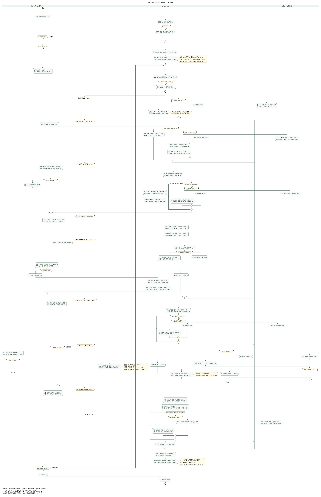

# 參、系統分析（續）

## 三、泳道圖

### （一）全系統泳道圖

本節主圖描述 FoodFlow **整個系統的操作流程與責任分工**，涵蓋八大功能模組與 FR-01～FR-18，不只呈現確認入庫或 FEFO 領用。圖從登入、權限判定及預警首頁開始，使用者依需求選擇本次功能，完成、取消或修正後可繼續選擇其他作業，最後登出。

圖上的功能分支是**任選入口**，不是每次必須依序完成的步驟。例如員工可以直接查庫存、登記領用或查看異動；管理者也可以直接維護主檔或盤點。進貨、領用、報廢與盤點不因上下排列而形成強制的業務順序。



[SVG 放大版](diagrams/b-swimlane-system-overview.svg)｜[PlantUML 原始檔](diagrams/b-swimlane-system-overview.puml)

### （二）泳道與參與角色

| 泳道 | 範圍 |
| --- | --- |
| 操作人員（共用作業） | 包括一般員工與管理者。負責登入登出、選擇功能、查詢、進貨、核對與提交領用／報廢，以及取消或修正輸入。管理者同樣可執行這些共用作業。 |
| FoodFlow 系統 | 負責登入驗證、每次請求授權、業務規則、FEFO 與預警計算、資料讀寫、交易、異動追溯與結果回饋。資料庫屬系統內部，不另列外部角色。 |
| 管理者（專屬作業） | 帳號與角色管理、基本資料維護、整批移位、進貨沖銷、預警天數設定、盤點差異調整、報廢分布與損失金額分析。 |

管理者泳道不是一般員工作業的審核關卡。一般員工建立進貨、確認入庫、領用與報廢時，只要權限及資料符合規則，即可由系統執行，不新增主管簽核需求。各管理者專屬入口均保留授權判斷，直接呼叫無權限功能也須拒絕。

### （三）八大模組與需求覆蓋

圖中 `[1.1]`～`[8.3]` 沿用 GitHub B 文件的功能清單編號，不是前一版細部圖的 Use Case 步驟編號。

| 模組 | 圖中功能 | SRS 需求 | 權限與關鍵規則 |
| --- | --- | --- | --- |
| 1.0 帳號與權限管理 | 1.1 登入登出；1.2 員工帳號管理；1.3 角色權限控管 | FR-01、FR-02 | 所有人須登入；帳號及角色維護限管理者。停用後既有登入不可繼續操作；最後一名有效管理者不得停用或降權。 |
| 2.0 基本資料與儲存位置 | 2.1 食材與分類；2.2 供應商；2.3 儲存位置；2.4 整批位置變更 | FR-03～FR-05 | 共用查詢；維護與移位限管理者。保留歷史引用；移位記原／新位置與原因，不改數量或效期。 |
| 3.0 進貨與批次管理 | 3.1 草稿；3.2 確認入庫；3.3 進貨查詢；3.4 進貨沖銷 | FR-06、FR-07 | 進貨與查詢共用，沖銷限管理者。草稿不增庫存；每筆明細建立唯一批次及進貨異動。已有後續異動不得直接沖銷。 |
| 4.0 批次庫存查詢 | 4.1 庫存總覽；4.2 批次與來源／異動追查 | FR-08、FR-09 | 共用。實體、可用、過期、安全量分開；位置篩選只合計符合位置的批次，耗盡批次保留歷史。 |
| 5.0 領用與消耗登記 | 5.1 FEFO 建議；5.2 非 FEFO 選批；5.3 確認領用 | FR-10、FR-11 | 共用。依到期日、進貨日、批號排序；不足拒絕；偏離建議須原因。提交時重新檢查效期與最新剩餘量。 |
| 6.0 效期與低庫存預警 | 6.1 效期提醒；6.2 低庫存；6.3 預警首頁與連結；6.4 預警天數 | FR-12～FR-14 | 查詢共用，設定限管理者。頁面載入、重新整理及操作成功後更新；過期不自動扣庫存，過期批次不得領用。 |
| 7.0 報廢與盤點 | 7.1 報廢；7.2 過期批次全數報廢；7.3 盤點差異調整 | FR-15、FR-16 | 報廢共用，盤點限管理者。報廢需確認；盤點舊預覽失效須重核，無差額不新增數量異動。 |
| 8.0 異動紀錄與統計 | 8.1 異動／位置變更；8.2 期間庫存；8.3 報廢分布與損失金額 | FR-17、FR-18 | 異動及期間統計共用，報廢分析與損失金額限管理者。紀錄不可直接修改或刪除，不同單位分列。 |

### （四）整體作業說明

1. **登入與首頁：**系統檢查帳號、密碼與有效狀態，依角色提供功能。登入後顯示預警首頁，依過期、今日到期、即期、低庫存排序；登入失敗可重新嘗試或結束。
2. **依需求選擇：**使用者可從導覽列或預警連結選擇本次作業，系統於每次請求重新驗證登入與授權。主檔及管理功能不是一般營運前每次都必須執行的步驟。
3. **主檔與管理：**管理者可維護帳號、食材、分類、供應商及位置，或處理移位、沖銷、設定與盤點。一般員工仍可查詢主檔供交易選用，不能維護。
4. **庫存作業：**進貨草稿與確認分開；領用及報廢須核對後提交；取消不扣庫存。盤點依差額處理，不能直接覆寫歷史。寫入一律驗證通過才執行，失敗時整筆不生效。
5. **查詢與追溯：**庫存、批次、進貨來源、數量異動及位置變更可互相追查。報表依權限顯示，報廢分析與損失金額不得提供一般員工存取。
6. **回饋與結束：**完成或拒絕本次作業後回傳結果；成功寫入後更新相關查詢與預警。使用者可繼續任選功能，或登出使登入狀態失效。

### （五）跨模組一致性規則

- **日期及 FEFO：**日期取 Asia/Taipei。領用排除過期與零庫存批次；暫定政策 A7 為今日到期仍可領用、次日起禁止，排序與 SRS 保持一致。
- **預警：**可用量不含過期量，安全庫存量為零時不提醒；安全量大於零且可用量小於或等於安全量才觸發低庫存。預警是查詢計算，不新增每日排程、Email、簡訊或背景推播。
- **交易及重送：**確認入庫、多批次領用、報廢、盤點與沖銷遵循整筆成功或全部回滾；同次操作重送不重複生效。回應中斷先查詢既有結果或沿用同次操作重試，不能直接當作尚未寫入。
- **原因及歷史：**非 FEFO、報廢、盤點、移位與沖銷保留適用原因、操作者及時間；被引用主檔及庫存異動保留歷史。數量異動與位置變更分開，不把整批移位誤作領用或調整數量。
- **金額及統計：**未知單價不推算為零；報廢金額只合計已知單價並標示未知筆數。期間統計為期初＋淨進貨－淨領用－淨報廢＋調整＝期末，沖銷依實際確認時間反映，不重複計算。
- **圖表層次：**本圖是全系統需求分析總覽，將詳細欄位驗證及每種錯誤合併描述；不改寫 SRS、使用案例或實作規則，也不表示每項功能已完成測試。

### （六）編製依據與範例差異

- 依據 [GitHub SRS v3.0](https://github.com/Software-engineering-foodflow/foodflow/blob/main/docs/srs.md)、[B 功能需求與功能清單](https://github.com/Software-engineering-foodflow/foodflow/blob/main/docs/b-functional-requirements.md)、[B 系統分析](https://github.com/Software-engineering-foodflow/foodflow/blob/main/docs/b-system-analysis.md)及[團隊分工](https://github.com/Software-engineering-foodflow/foodflow/blob/main/docs/team-tasks.md)，沿用角色、八大模組及功能編號。
- 使用者提供的 `srs.md` 與專案 [SRS](srs.md)一致；本圖涵蓋其全部 FR-01～FR-18。
- 參考 `B-軟體需求分析文件-軟工期末-G2.pdf` 的泳道圖（PDF 第 17 頁，頁面標示第 16 頁），採全系統角色責任分區與條件分支，不沿用醫療業務。
- 謝文佳的分工列出兩張核心案例泳道圖；依本次要求，另補**全系統總覽作為本節主圖**。總覽與核心案例屬不同層次，不增加新的系統功能。
- 舊分工 PDF 中的每日預警排程角色，與目前 GitHub 首版邊界不同，因此不加入本圖。供應商與資料庫也不列為外部使用者角色。
- SRS 的 A1～A7 仍維持既有暫定方案；本圖不將未確認假設改稱正式定案。

### （七）使用與重新渲染

Word／簡報建議使用 SVG，放大仍清楚。全系統圖包含全部入口及關鍵判斷，屬較長的總覽圖，不宜縮小後要求逐字閱讀。

在專案根目錄執行既有本機工具：

```powershell
& tools/java/jdk-21.0.13+9-jre/bin/java.exe -jar tools/plantuml/plantuml.jar -charset UTF-8 -tsvg docs/diagrams/b-swimlane-system-overview.puml
& tools/java/jdk-21.0.13+9-jre/bin/java.exe -DPLANTUML_LIMIT_SIZE=16000 -jar tools/plantuml/plantuml.jar -charset UTF-8 -tpng docs/diagrams/b-swimlane-system-overview.puml
```

本節保留全系統泳道圖，兩組單功能細部圖已依使用者決定移除。ER／類別圖、其他組員文件、D 文件、程式碼、Schema 與 AI 紀錄未修改，未執行 commit 或 push。