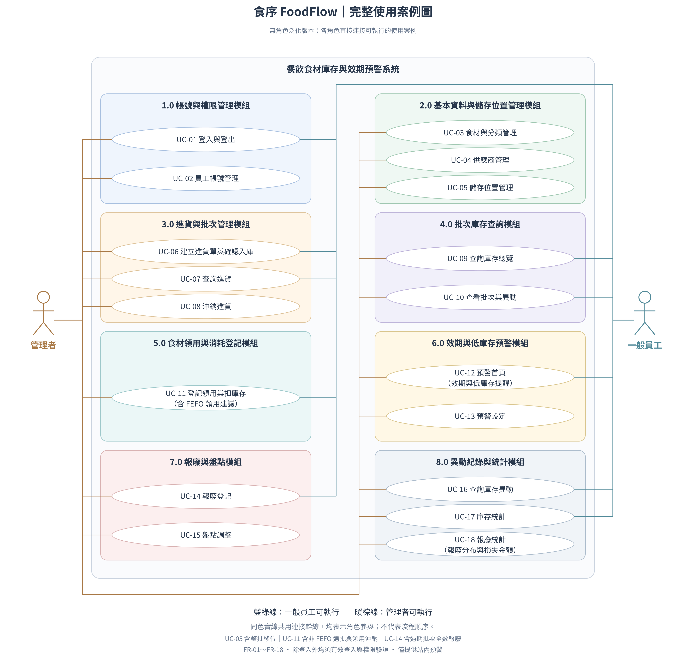

# 參、系統分析

## 一、使用案例圖

圖 1　食序 FoodFlow 使用案例圖

本系統依八大功能模組，將功能整理為 18 個使用案例，涵蓋登入、基本資料維護、進貨、庫存查詢、領用、預警、報廢、盤點及統計。各使用案例以使用者完成的作業目標為單位，相關細功能納入同一案例，並以對照表連結至功能清單與正式需求編號。

使用案例圖分別呈現管理者與一般員工可執行的功能；管理者直接連接全部使用案例，一般員工連接其可執行的日常作業。

### （一）使用者角色與圖示關係

1. 一般員工：可登入及登出、建立與查詢進貨、查詢庫存與批次、領用及領用沖銷、查看預警、登記報廢、查詢異動及查看期間庫存統計。

2. 管理者：具有一般員工的全部操作權限，另可管理帳號、食材與分類、供應商、儲存位置，執行進貨沖銷、預警設定、盤點調整及查看報廢統計。

圖中包含 18 個使用案例，管理者可執行全部案例，一般員工可執行其中 10 個案例。角色與使用案例間的實線表示參與關係，不表示操作先後順序。藍綠色連線表示一般員工可執行，暖棕色連線表示管理者可執行。

除登入外，各項營運操作皆須使用有效帳號登入並通過伺服器端權限檢查。登入作為前置條件，不以包含關係重複連接至每個使用案例。

### （二）使用案例與功能需求對照

| 模組 | 使用案例 | 參與角色 | 功能清單編號 | 需求編號 |
| --- | --- | --- | --- | --- |
| 1.0 帳號與權限管理 | UC-01 登入與登出 | 一般員工、管理者 | 1.1 | FR-01 |
| 1.0 帳號與權限管理 | UC-02 員工帳號管理 | 管理者 | 1.2、1.3 | FR-02 |
| 2.0 基本資料與儲存位置管理 | UC-03 食材與分類管理 | 管理者 | 2.1 | FR-03 |
| 2.0 基本資料與儲存位置管理 | UC-04 供應商管理 | 管理者 | 2.2 | FR-04 |
| 2.0 基本資料與儲存位置管理 | UC-05 儲存位置管理 | 管理者 | 2.3、2.4 | FR-05 |
| 3.0 進貨與批次管理 | UC-06 建立進貨單與確認入庫 | 一般員工、管理者 | 3.1、3.2 | FR-06 |
| 3.0 進貨與批次管理 | UC-07 查詢進貨 | 一般員工、管理者 | 3.3 | FR-07 |
| 3.0 進貨與批次管理 | UC-08 沖銷進貨 | 管理者 | 3.4 | FR-07 |
| 4.0 批次庫存查詢 | UC-09 查詢庫存總覽 | 一般員工、管理者 | 4.1 | FR-08 |
| 4.0 批次庫存查詢 | UC-10 查看批次與異動 | 一般員工、管理者 | 4.2 | FR-09 |
| 5.0 食材領用與消耗登記 | UC-11 登記領用與扣庫存 | 一般員工、管理者 | 5.1～5.4 | FR-10、FR-11 |
| 6.0 效期與低庫存預警 | UC-12 預警首頁 | 一般員工、管理者 | 6.1、6.2、6.3 | FR-12、FR-13、FR-14 |
| 6.0 效期與低庫存預警 | UC-13 預警設定 | 管理者 | 6.4 | FR-14 |
| 7.0 報廢與盤點 | UC-14 報廢登記 | 一般員工、管理者 | 7.1、7.2 | FR-15 |
| 7.0 報廢與盤點 | UC-15 盤點調整 | 管理者 | 7.3 | FR-16 |
| 8.0 異動紀錄與統計 | UC-16 查詢庫存異動 | 一般員工、管理者 | 8.1 | FR-17 |
| 8.0 異動紀錄與統計 | UC-17 庫存統計 | 一般員工、管理者 | 8.2 | FR-18 |
| 8.0 異動紀錄與統計 | UC-18 報廢統計 | 管理者 | 8.3 | FR-18 |

功能 1.3「角色權限控管」同時適用於全部使用案例，UC-02 涵蓋角色指派，各項操作則各自驗證權限。一般員工可查詢食材、分類、供應商與儲存位置等基本資料，供庫存查詢及交易選用；圖中的 UC-03～UC-05 表示管理者專屬的維護作業，不代表禁止員工查詢資料。

### （三）功能整合與系統邊界

- 進貨作業：建立草稿與確認入庫合併為 UC-06；查詢與沖銷依不同權限拆為 UC-07、UC-08。

- 領用作業：UC-11 納入 FEFO 領用建議、跨批次領用、非 FEFO 選批與原因登記，以及確認扣庫存，並涵蓋最近領用紀錄與整次領用沖銷。建議、改選及確認為同一領用作業中的流程；沖銷為登記錯誤的更正功能。

- 預警作業：UC-12 統整過期、今日到期、即期與低庫存提醒、篩選及作業連結；管理者設定預警天數另列 UC-13。預警連結提供作業入口，實際領用、報廢與進貨仍由各自案例處理。

- 報廢作業：一般報廢與過期批次一鍵全數報廢均納入 UC-14；過期不自動扣除庫存，須由員工確認報廢。

- 統計作業：庫存統計與報廢統計依權限拆為 UC-17、UC-18；報廢分布與損失金額僅管理者可查看。

- 系統邊界：圖中僅列管理者與一般員工；供應商不登入，資料庫屬內部實作，不列為外部角色。本系統預警於頁面載入、重新整理及操作成功後更新，不加入每日排程或外部通知角色。

## 二、核心 Use Case 規格說明

本節選擇「確認入庫」與「FEFO 領用」兩項核心作業，詳細描述參與者、前置條件、觸發事件、主要流程、替代流程、例外流程及後置條件，作為後續泳道圖、循序圖與驗收測試的依據。案例編號沿用前節使用案例圖；員工包含一般員工與管理者，系統及資料庫為處理流程中的內部組成，不另列為外部參與者。

### （一）確認入庫

| 項目 | 說明 |
| --- | --- |
| Use Case 編號 | UC-06 |
| Use Case 名稱 | 建立進貨單與確認入庫 |
| 主要角色 | 員工（一般員工、管理者） |
| 次要角色 | 無外部次要角色；供應商不登入系統 |
| 關聯模組 | 進貨與批次管理、基本資料與儲存位置管理、批次庫存查詢、異動紀錄與統計、效期與低庫存預警 |
| 對應需求 | FR-06，並適用 FR-03～FR-05 的基本資料規則 |
| 功能清單對應 | 3.1 建立及編輯進貨草稿、3.2 確認入庫與建立批次 |
| 優先順序 | 高；為後續庫存查詢、領用、預警及報廢的資料來源 |
| 作業目的 | 將已核對的進貨草稿確認為正式進貨，建立可追溯來源的批次庫存與進貨異動 |

UC-06 涵蓋建立進貨草稿與確認入庫兩個階段。以下詳細規格說明草稿建立後的確認入庫流程，因此以前置條件「系統已有待確認的進貨草稿」作為流程起點。

#### 前置條件

1. 員工已使用有效帳號登入，並具有進貨作業權限。

2. 系統已有待確認的進貨草稿，尚未計入庫存。

3. 系統已有供應商、食材及儲存位置資料可供核對；實際確認時仍須檢查其有效狀態。

4. 員工已取得實際收貨資料，準備核對數量、到期日、位置與可選填的單價。

#### 觸發事件（Trigger）

員工開啟進貨草稿，核對內容並選擇「確認入庫」。

#### 主要流程

1. 員工開啟待確認的進貨草稿。

2. 系統顯示供應商、進貨日期及各筆明細，包括食材、數量、單價、到期日與儲存位置。

3. 員工依實際收貨結果核對資料；同一食材若到期日或位置不同，分別登記為不同明細，完成後選擇「確認入庫」。

4. 系統於提交當下驗證登入與權限，確認單據仍可確認，供應商、食材及位置皆有效，且至少有一筆明細。

5. 系統驗證各筆明細：進貨量須大於零且最多三位小數；填寫單價時須為非負數；到期日必填；進貨日期不得晚於當天，到期日不得早於進貨日或確認當天。

6. 系統在同一交易中確認整張進貨單，為每筆明細建立唯一批次，保存來源明細、食材、到期日、位置、單價、初始量與剩餘量；初始量及剩餘量均等於該筆進貨量。

7. 系統為每個新批次建立進貨異動，記錄數量增加、異動前後量、來源單據、操作者及確認時間，並完成整筆交易。

8. 系統回傳確認成功結果及批次資訊；庫存總覽可查到新增庫存，相關畫面依最新數量與日期更新預警資訊。

#### 替代流程

- 3a. 資料尚未核對完成或尚無到期日：員工保留進貨草稿，待資料齊全後重新確認；草稿不建立批次、不增加庫存。

- 3b. 未填進貨單價：單價允許留空，其他資料通過驗證後接續步驟 6；系統保留單價未知狀態，後續報廢時不得將未知單價推算為零。

- 4a. 同一進貨單已成功確認，員工再次確認或重試：系統辨識既有確認結果，回饋單據已確認及可查詢的既有結果，不再建立批次或增加庫存。

#### 例外流程

- 4b. 登入失效、帳號停用或權限不足：系統拒絕操作，不執行入庫；員工須重新登入或由具權限人員處理。

- 4c. 單據已沖銷或狀態不允許確認：系統拒絕本次確認並提示目前狀態，不新增批次與異動。

- 4d. 供應商、食材或位置已停用，或沒有有效明細：系統指出無效資料，要求員工重新選擇或補齊內容；本次確認不增加庫存。

- 5a. 欄位缺漏、數量精度超限、數量或單價不合法、日期不符規則：系統指出錯誤欄位並保留已填內容，員工修正後回到步驟 3；整張單不得部分入庫。

- 6a～7a. 建立批次、建立異動或提交交易失敗：系統撤回本次交易的所有資料變更，不留下部分完成的確認結果，並提示操作未完成。

- 8a. 交易已成功但回應中斷：不得僅因未收到畫面回應再次增加庫存；員工重新查詢單據狀態，或以同一確認操作重試，由系統辨識既有結果。

#### 後置條件

1. 成功時：進貨單為已確認狀態，每筆明細對應一個唯一批次及一筆進貨異動，批次增加量與明細數量一致。

2. 成功時：批次可追查原進貨單、明細與供應商；操作者、確認時間與進貨單價（含未知狀態）均獲保留。

3. 未成功時：本次確認不造成部分入庫；若僅保留草稿，庫存仍不變。

4. 重試時：同一進貨確認僅生效一次；若先前已成功，保留既有結果，不重複入庫。

### （二）FEFO 領用

| 項目 | 說明 |
| --- | --- |
| Use Case 編號 | UC-11 |
| Use Case 名稱 | 登記領用與扣庫存（含 FEFO 領用建議） |
| 主要角色 | 員工（一般員工、管理者） |
| 次要角色 | 無外部次要角色 |
| 關聯模組 | 食材領用與消耗登記、批次庫存查詢、異動紀錄與統計、效期與低庫存預警 |
| 對應需求 | FR-10、FR-11 |
| 功能清單對應 | 5.1 FEFO 領用建議、5.2 非 FEFO 批次選擇、5.3 確認領用與扣除庫存 |
| 優先順序 | 高；為食材消耗登記與效期優先使用的核心流程 |
| 作業目的 | 依 FEFO 提供批次建議，由員工核對實際拿取批次與數量後扣除庫存，並保留完整領用異動 |

#### 前置條件

1. 員工已使用有效帳號登入，並具有領用作業權限。

2. 系統已有食材及其批次資料可供查詢；是否有足夠可用庫存，由流程中依最新數量判斷。

3. 員工已知所需食材與需求量，並能在確認前核對實際拿取的批次及數量。

#### 觸發事件（Trigger）

員工進入食材領用功能，選擇欲領用的食材。

#### 主要流程

1. 員工進入領用畫面，選擇食材並輸入需求量。

2. 系統驗證需求量大於零，依單位檢查整數或最多三位小數，依 Asia/Taipei 當日日期取得未過期且有剩餘量的批次，計算目前可用庫存量。

3. 系統確認可用庫存足以滿足需求後，依到期日由早到晚排序；到期日相同時，依進貨日期、批號排序。

4. 系統顯示批號、到期日、位置、可用數量及各批次建議領用量，優先分配最早到期批次；不足時接續下一批，直到滿足需求量。

5. 員工依建議核對實際拿取的批次與數量，確認內容後提交領用。

6. 系統於提交當下再次驗證登入、權限、批次效期及剩餘量，確認各批次領用量大於零、未超過最新剩餘量，並重新計算同總需求量之 FEFO 分配，檢查超出建議量的批次是否已填非 FEFO 原因。

7. 系統在同一交易中扣除各批次庫存，為每個被扣批次建立領用異動，保存來源、操作者、時間、增減量、前後量，以及非 FEFO 標記與原因（如適用），完成整筆交易。

8. 系統回傳領用成功結果與更新後庫存，相關畫面依最新數量與日期更新效期及低庫存提醒。

#### 替代流程

- 4a. 單一批次不足，但合計可用庫存足夠：系統跨批次分配建議量，員工核對各批次實際拿取量後接續步驟 5，整次領用仍須全部成功或全部不生效。

- 5a. 員工改選其他可用批次：員工依實際拿取情形調整批次與數量，偏離 FEFO 建議時填寫原因，再接續步驟 6；成功後超出 FEFO 建議分配量的批次異動標記為「非 FEFO」。

- 5b. 員工更改需求量：系統依新的需求量及當下可用批次重新產生建議，回到步驟 2，由員工重新核對後提交。

- 5c. 員工取消且尚未提交：結束本次登記，不扣庫存、不建立領用異動；若尚未完成實際拿取，依餐廳現場作業處理。

#### 例外流程

- 2a. 需求量為零、負數、超過三位小數，或不可分割單位輸入小數：系統拒絕無效輸入並指出錯誤，員工修正後回到步驟 1，不得靜默截斷數量。

- 3a. 無可用批次或需求量超過可用庫存量：系統拒絕本次領用，顯示目前可用量，不扣庫存；員工調整需求或待補貨後重新操作。

- 6a. 登入失效、帳號停用或權限不足：系統拒絕操作，不建立異動；員工須重新登入或由具權限人員處理。

- 6b. 選用過期、零庫存批次，或因跨日使所選批次已過期：系統拒絕提交並更新可用批次資訊，要求員工重新核對實際批次；不得只依先前畫面的狀態扣庫存。

- 6c. 非 FEFO 領用未填原因：系統提示補填原因，保留已選內容，補齊後再次提交驗證。

- 6d. 他人同時領用或其他異動造成剩餘量不足：系統拒絕本次整筆領用，回傳最新可用量與提示，要求員工重新核對批次及數量，不得部分扣除或產生負庫存。

- 7a. 扣庫存、建立異動或提交交易失敗：本次所有批次扣除與異動均不生效，系統提示未完成，員工核對狀態後再操作。

- 8a. 回應中斷或同次提交重送：系統須確保同一筆交易不重複扣庫存；員工先查詢既有領用異動或以同次操作重試，不能因畫面未收到回應就視為未扣庫存。

#### 後置條件

1. 成功時：各批次剩餘量依實際領用量扣除，皆不得為負；每個被扣批次各有一筆領用異動，能追查操作者、時間及數量變化。

2. 成功時：超出同總需求量之 FEFO 分配建議的批次，保留原因與非 FEFO 標記；已耗盡批次保留歷史，但不再列入可用批次及待處理效期預警。

3. 成功時：後續庫存與預警查詢反映更新後的可用量；符合低庫存條件時顯示提醒。

4. 未成功或未提交時：本次登記不改變任何批次數量、不留下部分領用異動；若原提交已成功但回應中斷，保留原結果，重送不得再次扣除。

共用作業規則

1. 效期以 Asia/Taipei 當日日期計算。到期日早於今天為過期；等於今天為今日到期；晚於今天且距今天不超過預警天數為即期，其餘為正常。預設提前三天提醒，管理者可調整為非負整數；設為零時不產生即期提醒。

2. 今日到期且有剩餘量的批次可領用，次日起禁止領用。實體庫存量為各批次剩餘量合計，可用庫存量則排除過期批次；過期不自動報廢，仍須由人員確認並登記。

3. 確認入庫與多批次領用皆以完整交易處理，全部成功或全部不生效。同一筆確認或同次領用重送時，不重複增加或扣除庫存。

4. 領用登記完成後如需更正，可由最近領用紀錄填寫原因，沖銷整次領用並加回原批次，再重新登記；原異動與沖銷異動均保留。

5. 預警依查詢當下日期與庫存更新；庫存異動成功後，相關查詢重新取得資料。日期提醒不取代餐廳人員對食材實際狀況的判斷。
