# 食序 FoodFlow：軟體設計文件（C）

第 17 組。需求依據為 SRS v3.0（`docs/srs.md`），完整設計規則見 `_bmad-output/planning-artifacts/architecture/architecture-foodflow-2026-11-05/ARCHITECTURE-SPINE.md`。

> 交件版本：[PDF](c-software-design.pdf)、[Word](c-software-design.docx)，格式參考課程範例（G2）。本文第壹、貳章與交件版本內容相同；附錄是交件版本未收錄的補充設計，仍是有效的設計說明。2026-11-13 依目前程式碼（commit `63438cf`）核對。
>
> 圖檔由 `diagrams/c-html/` 的 HTML 原始檔產生：`node shot.cjs <html> <輸出.png> [hl=群組&tag=標籤] 2`。

## 壹、系統簡介

### 一、專案動機與目的

許多餐廳的食材仍以紙本或試算表管理：進貨時沒有記錄效期，領用時憑印象拿，發現過期時往往只能報廢；也常常用完才發現沒叫貨。餐廳的食材品項、批次、儲存空間與經手的員工越多，靠人記憶就越不可靠。

本系統旨在**解決食材效期不清、領用順序混亂、缺料才發現與浪費原因難以追查等問題**。食序 FoodFlow 集中記錄每次進貨及其庫存批次，讓員工清楚知道還有哪些食材、剩多少、放在哪裡、哪一批應該先使用，並留下領用、報廢與盤點調整的紀錄，**協助餐廳降低缺料與食材浪費的風險**。

目前沒有實際餐廳的試用數據，因此不預設能降低特定百分比的損耗。系統依輸入的日期提供提醒，不取代員工對食材狀況的判斷。

### 二、系統特色

本系統**提供批次入庫、先到期先使用（FEFO）領用、效期與低庫存預警、報廢與盤點、異動追溯及統計等完整功能**。庫存以批次而非品項追蹤，同一食材不同到期日、位置與單價分開記錄；首頁依過期、今日到期、即期與低庫存排序，可直接進入領用、報廢或建立進貨單。後端以**交易與資料列鎖定機制避免超領與重複入庫**，所有數量變動都留下操作者、時間與來源，可由異動紀錄重算目前庫存。其系統示意圖如下所示：

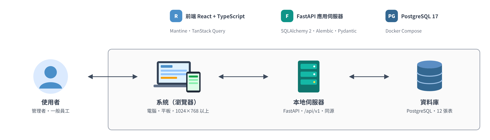

*圖 1　食序 FoodFlow 系統示意圖*

### 三、使用者定位

本系統的主要**使用族群為單一門市、非連鎖的獨立餐廳**，不限規模，以平板及電腦 Web 操作。店長以管理者身分掌握庫存與效期、維護基本資料與帳號權限並檢視報廢與盤點差異；收貨與廚房人員以一般員工身分記錄進貨、依批次建議領用並登記報廢。**依角色設計差異化的功能與權限**，供應商不登入本系統，首版也不提供連鎖總部、跨分店調撥與中央廚房功能。

| 使用者 | 主要工作 | 系統權限 |
| --- | --- | --- |
| 餐廳負責人／店長 | 掌握庫存與效期、維護資料與權限、檢視報廢及盤點差異 | 管理者 |
| 收貨／採購人員 | 記錄進貨、到期日、單價與位置，知道哪些食材要補貨 | 一般員工 |
| 廚房／備料人員 | 查找食材、依批次建議領用、登記報廢 | 一般員工 |

## 貳、系統架構

### 一、系統架構圖

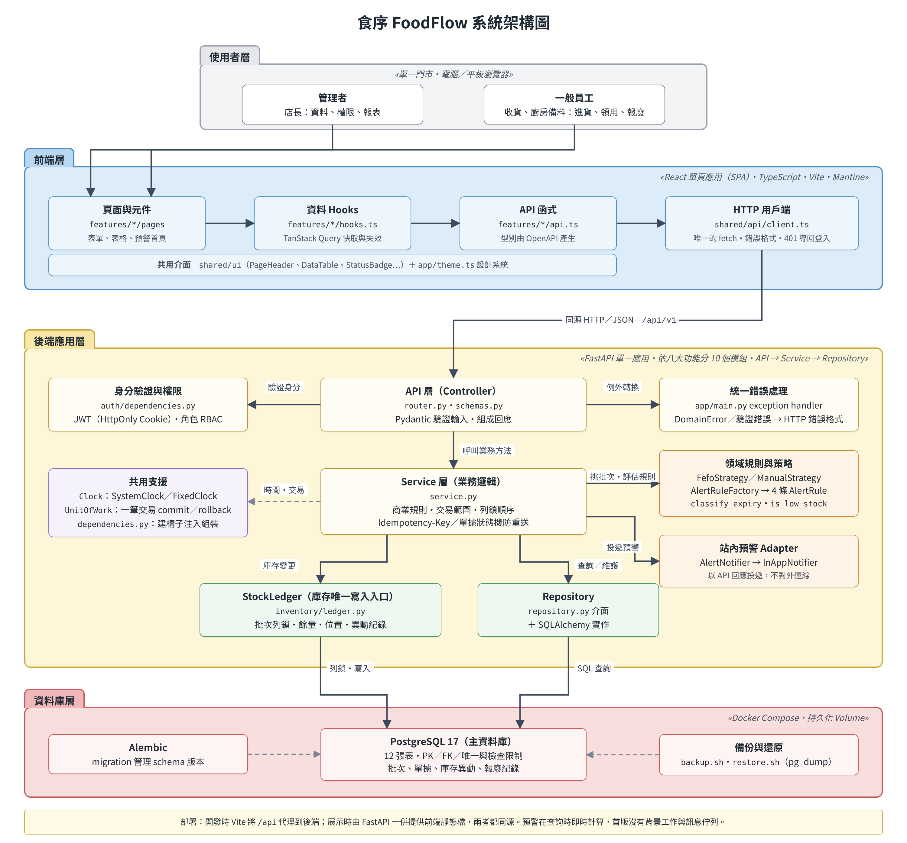

*圖 2　食序 FoodFlow 系統架構圖*

本系統整體採用**前後端分離之三層式架構，將使用者介面、應用程式邏輯與資料儲存明確區隔**，以提升系統的可維護性與可測試性。系統主要可分為前端層、後端應用層與資料庫層，各層所使用之技術與職責說明如下。

首先，**前端層負責提供使用者操作介面**。本系統前端**採用 React 與 TypeScript 建構單頁式應用程式**，以 Vite 建置、Mantine 元件組成畫面。管理者與一般員工皆透過電腦或平板瀏覽器使用系統，前端依功能分成與後端同名的模組資料夾，**透過同源 HTTP 呼叫後端提供之 `/api/v1` RESTful API 交換資料**，並以 TanStack Query 統一管理伺服器資料的快取與更新。

第二，**後端應用層為系統核心，負責處理所有商業規則與交易**。後端**採用 Python 搭配 FastAPI 框架**，依八大功能切成 10 個模組，每個模組內再分為 API 層（Controller）、Service 層與 Repository 層。身分驗證以 **JWT 存放於 HttpOnly Cookie，並依角色檢查權限**；挑批次與預警規則以 Strategy、Factory 實作，預警結果經 Adapter 投遞；所有庫存數量變動**一律經由 StockLedger 寫入**，避免各功能各寫一套扣庫存邏輯。

最後，**資料庫層負責所有資料的持久化儲存**。本系統採用 **PostgreSQL 17 作為關聯式資料庫，儲存食材、供應商、儲存位置、進貨單、庫存批次、異動與報廢紀錄等 12 張資料表**，並透過 **SQLAlchemy ORM 與 Alembic 進行資料存取與版本控管**。資料庫以 Docker Compose 啟動並使用持久化 Volume，交易隔離等級為 READ COMMITTED，搭配資料列鎖定確保併發領用時不會產生負庫存。首版沒有背景工作與訊息佇列，預警在每次查詢時即時計算，因此不會與庫存不同步。

#### （一）前端層

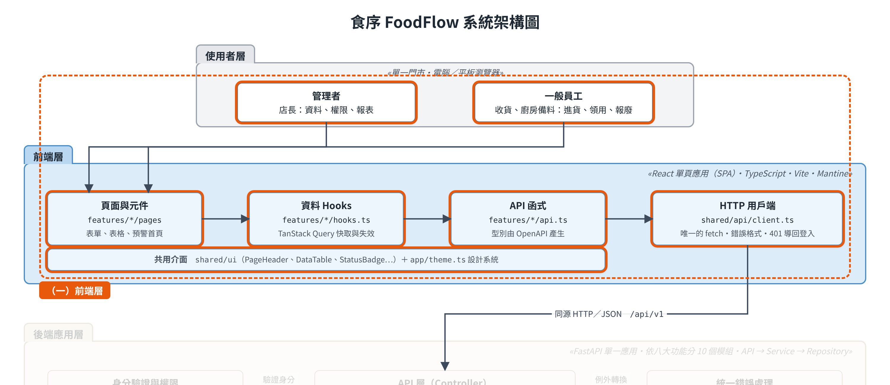

其範圍是圖中上方藍色區塊「前端層」，詳細內容如下所示：

**1. 角色與定位**

- 作為使用者唯一的操作介面，電腦與平板瀏覽器共用同一套 Web 介面。
- 負責畫面呈現、表單輸入與操作回饋；庫存數量、效期狀態與權限判定一律以後端回傳為準。

**2. 負責的任務**

- 由 `router.tsx` 集中管理頁面路由，`layout.tsx` 提供側欄導覽與頁框。
- 頁面透過各功能的 `hooks.ts`（TanStack Query）取得資料；會改庫存的操作成功後呼叫 `invalidateStockQueries()`，讓庫存、預警、統計等畫面一起更新。
- `api.ts` 每個端點一個函式，型別由後端 OpenAPI 以 `npm run gen:api` 產生，避免前後端欄位不一致。
- `shared/api/client.ts` 是唯一呼叫 fetch 的地方：以同源 Cookie 送出請求，把錯誤轉成 `ApiError`，遇到 401 導回登入頁。
- 領用與報廢表單由 `useIdempotencyKey` 產生 Idempotency-Key，避免重複送出。

**3. 不應包含的部分**

- 自行計算到期狀態、剩餘天數、低庫存或數量（數量一律以字串傳遞）。
- 頁面直接發出請求，或 import `api.ts`、`client.ts`（由 ESLint 規則擋下）。
- 權限的最終判斷：前端只決定是否顯示管理者功能，權限仍由後端檢查。

**4. 非功能性需求**

- 1024×768 不出現橫向捲動；進貨、領用、報廢、預警四頁另外檢查 1366×768。
- 可點擊目標至少 44px；狀態一律以文字加顏色呈現，不能只靠顏色（NFR-01）。

#### （二）API 層（Controller 層）

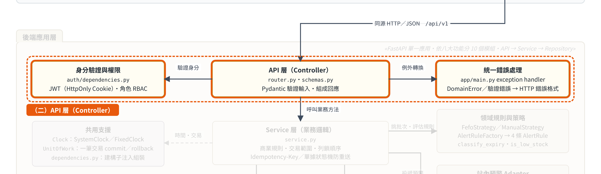

其範圍是圖中黃色區塊上方「API 層（Controller）」以及兩側的身分驗證與錯誤處理，詳細內容如下所示：

**1. 角色與定位**

- 系統對外的入口，對應各模組的 `router.py` 與 `schemas.py`，統一掛在 `/api/v1` 之下。
- 只負責接收請求、驗證輸入與權限，再把資料交給 Service，不處理商業邏輯。

**2. 功能描述**

- 解析 HTTP 請求（GET／POST／PATCH／DELETE）。
- 使用 Pydantic Schema 驗證 request body，例如數量超過三位小數時明確拒絕。
- 透過 `auth` 的 `get_current_employee` 從 HttpOnly Cookie 驗證 JWT，並依角色（管理者／一般員工）套用權限檢查；登入與健康檢查不需先登入。
- 讀取領用、報廢請求的 `Idempotency-Key` 標頭，呼叫對應的 Service 方法並轉成回應格式。

**3. 例外處理**

- 由 `app/main.py` 的單一 exception handler 把 `DomainError` 與格式錯誤轉成統一的錯誤格式，錯誤欄位以路徑標示（例如 `lines.0.quantity`）。
- 未預期的例外回 `500 INTERNAL_ERROR`，不回傳內部細節。

**4. 不應包含的部分**

- 資料庫查詢與 SQL。
- 商業規則。
- 交易控制與鎖定策略，或直接呼叫 Repository。

#### （三）Service 層（業務邏輯層）

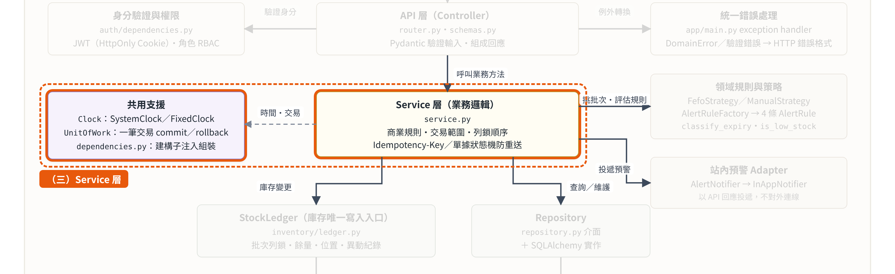

其範圍是圖中黃色區塊中間「Service 層（業務邏輯）」與左側「共用支援」，詳細內容如下所示：

**1. 角色與定位**

- 系統商業規則與交易的所在，對應各模組的 `service.py`。
- 處理確認入庫、FEFO 領用、報廢、盤點調整、進貨沖銷等需要跨表與鎖定的流程。

**2. 功能負責項**

- 以 `UnitOfWork` 決定交易範圍，每個寫入操作在單一交易內完成，全部成功或全部不生效。
- 協調 Repository、StockLedger、領域規則與 Clock；這些相依物件一律由建構子注入，在各模組的 `dependencies.py` 組裝，Service 不自行建立。
- 日期一律來自可注入的 `Clock`：正式環境使用 `SystemClock`，測試使用 `FixedClock`，判定依 Asia/Taipei 的當日日期。
- 執行商業規則，例如餘量是否足夠、單據狀態是否允許操作、手動改選批次時是否填寫原因。

**3. 防重送與併發**

| 操作 | 防護方式 | 重送結果 |
| --- | --- | --- |
| 確認入庫、進貨沖銷 | 單據狀態機，鎖單頭後檢查狀態 | 回 200 與單據目前狀態，不重複入庫 |
| 領用、報廢 | 前端帶 Idempotency-Key，鎖定後先查是否已處理 | 回 200 與原結果 |
| 盤點調整 | 帶預覽時的帳面量與該批次最後一筆異動編號，鎖定後比對 | 任一項不符時回 409 STALE_QUANTITY，要求重新預覽 |

兩人同時領用時，第二人在等到列鎖後會看到最新剩餘量；餘量不足時回 409 與最新可用量，不會產生負庫存。

**4. 例外處理**

- `INSUFFICIENT_STOCK`：可用量不足。
- `STALE_QUANTITY`：盤點預覽後批次已被異動。
- `STATE_CONFLICT`：單據狀態不允許此操作，例如沖銷尚未確認的進貨單。
- 交易區塊內發生任何例外時，由 UnitOfWork 全部回滾。

**5. 跨表流程例子**

- 確認入庫：鎖定進貨單頭 → 確認狀態為草稿 → 每一明細建立庫存批次 → 經 StockLedger 寫入批次與入庫異動 → 單據改為已確認。
- FEFO 領用：依 id 遞增鎖定候選批次 → 以注入的策略在鎖內重算建議 → 經 StockLedger 逐批扣減並寫入領用異動 → 偏離建議的批次標記為非 FEFO。

**6. 不應包含的部分**

- HTTP、SQL 與 SQLAlchemy `Session`。

#### （四）領域規則與策略（Strategy／Factory）

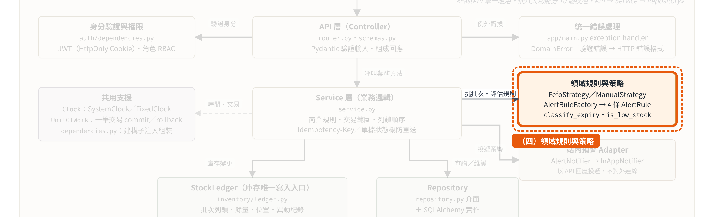

其範圍是圖中右側橘色區塊「領域規則與策略」，詳細內容如下所示：

**1. 角色與定位**

- 不依賴資料庫與 HTTP 的純邏輯，可單獨進行單元測試。
- 以 Strategy 與 Factory 模式隔離「容易改變的規則」，換規則時 Service 不用改。

**2. 主要元件**

- 批次挑選 `BatchSelectionStrategy`：`FefoStrategy` 依到期日、進貨日排序，先到期先使用；`ManualStrategy` 依員工指定的批次，須填原因並標記為非 FEFO。預設策略只在 `issue/dependencies.py` 的 `DEFAULT_STRATEGY` 一行設定。
- 預警規則 `AlertRule`：`AlertRuleFactory` 依預警天數建立過期、今日到期、即期、低庫存四條規則，每條規則獨立評估。
- 共用判定 `app/domain/`：`classify_expiry`、`days_until_expiry`、`is_low_stock`、`shortfall` 與單位換算，首頁預警與庫存總覽使用同一套判定。

**3. 不應包含的部分**

- 資料庫查詢、HTTP 與讀取系統時間；需要的資料與「今天」都由 Service 傳入。

**4. 例外處理**

- 不處理交易與 HTTP；規則結果交回 Service，由 Service 轉成 `DomainError`。

#### （五）站內預警 Adapter（通知系統）

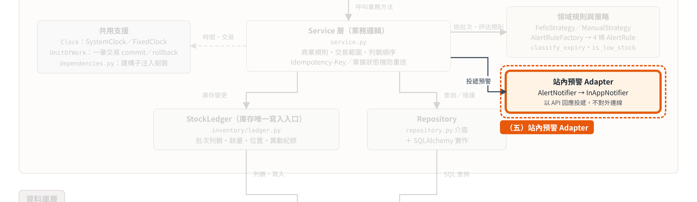

其範圍是圖中右側「站內預警 Adapter」，詳細內容如下所示：

**1. 角色與定位**

- 以 Adapter 隔離「預警結果」與「投遞管道」，介面為 `AlertNotifier`，首版實作 `InAppNotifier`。
- 投遞管道就是 API 回應，把預警交給首頁顯示，不對外連線。

**2. 運作流程**

- `AlertService.list_alerts()` 先呼叫 `evaluate()`：由 Repository 載入批次與庫存快照，交 Factory 建立的規則逐條評估，再依嚴重程度與到期日排序。
- 評估結果經 `InAppNotifier.deliver()` 同步回傳 `AlertResult`，由 API 交給首頁呈現。

**3. 預警種類與建議動作**

- 過期、今日到期、即期（天數可由管理者設定）、低庫存。
- 每筆預警附建議動作：領用、報廢或建立進貨單，首頁可一鍵前往。

**4. 設計限制與擴充**

- 預警在查詢時即時計算，不需要背景工作，也不會與庫存不同步。
- 期末若加 Email、LINE 等外部通知，只需新增一個 Notifier 實作與排程進入點；既有規則、`AlertService` 與查詢時使用的 `InAppNotifier` 都不用改，查詢頁面時也不會觸發外部通知。

#### （六）StockLedger 與 Repository 層（資料存取層）

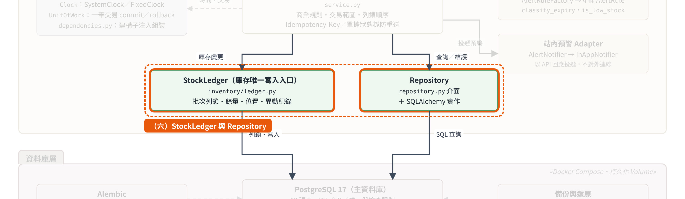

其範圍是圖中下方綠色區塊「StockLedger」與「Repository」，詳細內容如下所示：

**1. 角色與定位**

- Repository 隔離一般資料存取：介面在 `repository.py`，SQLAlchemy 實作在 `repository_sqlalchemy.py`，以業務語言提供查詢與儲存。
- StockLedger 是庫存專用的資料存取元件：批次剩餘量、批次位置與異動紀錄**只能經由它修改**。

**2. StockLedger 的規則**

- 是批次列鎖的唯一入口，一律依 `id` 遞增上鎖以避免死結，鎖定後一定讀取最新值。
- 每次異動同時寫入批次餘量與異動紀錄，並在異動中留下前後量，可由異動紀錄重算庫存。
- 進貨、領用、報廢、盤點、沖銷與換位置共用同一個契約，具體實作只 flush，不自行 commit。

**3. 注意事項**

- Repository 與 StockLedger 不處理商業判斷，也不 commit 或 rollback（交易屬於 Service）。
- 把資料庫限制違反（例如唯一鍵）依 constraint 名稱轉成 `DomainError`，上層不接觸 SQLAlchemy 的例外。
- 關聯不可延遲載入，需要的關聯在查詢時一併載入。

**4. 已知取捨**

SQLAlchemy 模型同時作為實體類別，Service 因此間接依賴 SQLAlchemy，沒有達到領域層完全獨立。原因是四人要在期中前完成 12 張表與八大功能，另建映射層等於每張表多寫一套類別與轉換。代價由三點控制：Service 不可直接 import `sqlalchemy`、關聯不可延遲載入、Strategy 與 AlertRule 使用純資料物件。

#### （七）資料庫層

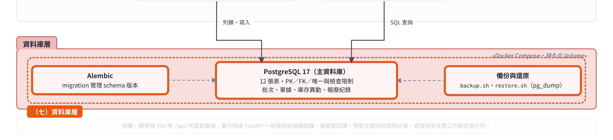

其範圍是圖中最下方紅色區塊「資料庫層」，詳細內容如下所示：

**1. 角色與定位**

- 以 PostgreSQL 17 持久化儲存全部 12 張資料表，由 Docker Compose 啟動並使用持久化 Volume。

**2. 資料完整性**

- 以主鍵、外鍵、唯一與檢查限制維持資料完整性；數量欄位使用 `NUMERIC(12,3)`，避免浮點誤差。
- 連線隔離等級為 READ COMMITTED，搭配 StockLedger 的資料列鎖定處理併發。

**3. 版本控管與維運**

- 以 Alembic migration 管理 schema 版本，四人的資料表結構保持一致。
- 以 `scripts/backup.sh`、`restore.sh`（pg_dump／pg_restore）進行備份與還原（NFR-06）。

### 二、軟體設計架構

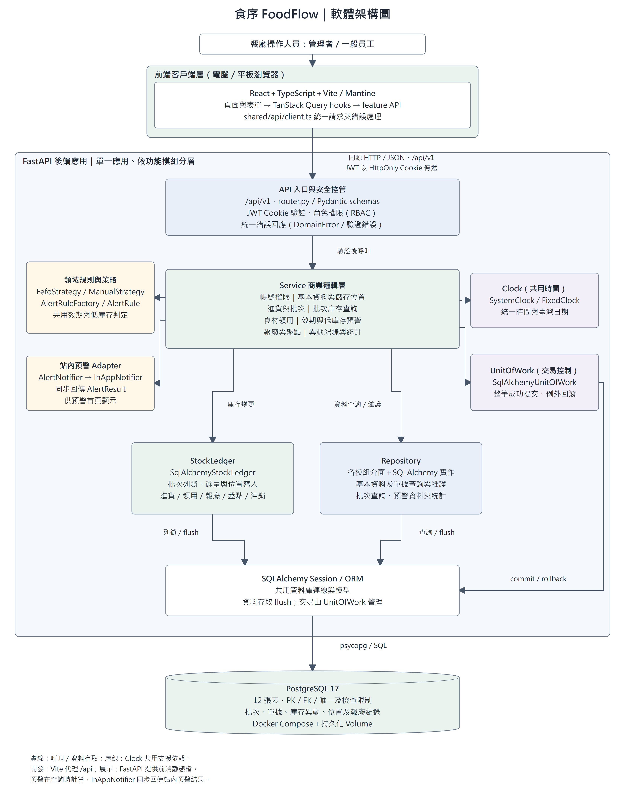

*圖 3　食序 FoodFlow 軟體設計架構圖*

本系統採用 **Python 的 FastAPI 作為核心應用框架，並依循分層式架構理念**建構後端服務。整體架構分為 API 層（Controller）、Service 層與 Repository 層，前端統一經由同源的 `/api/v1` 進入，在 FastAPI 內完成身分驗證、角色權限與輸入驗證；Service 層再搭配領域規則與策略、站內預警 Adapter、Clock 與 UnitOfWork，庫存寫入集中於 StockLedger，最後經 SQLAlchemy Session 存取 PostgreSQL。圖中方塊代表邏輯分層，並非各自獨立部署的服務；本系統沒有獨立的 API Gateway、負載平衡器或訊息佇列。

選擇此分層架構的原因在於其**明確的模組邏輯劃分**。分層能有效降低各模組間的耦合度，業務邏輯與資料存取明確分離，使**單元測試可以注入 FixedClock 與替身 Repository 獨立驗證每一層**；Strategy、Factory 與 Adapter 讓挑批次規則、預警規則與通知管道可以替換而不改動 Service。分層依賴與模組邊界由 CI 的 import-linter 規則持續檢查，讓四人平行開發時仍維持一致的結構。

### 三、子系統切割

#### （一）切割方式

本系統**依 SRS 第 4 節的八大功能切分子系統**，後端模組位於 `backend/app/modules/<模組>/`，前端 feature 位於 `frontend/src/features/<模組>/`，兩邊使用相同的資料夾名稱。子系統之間的關係如下圖所示：

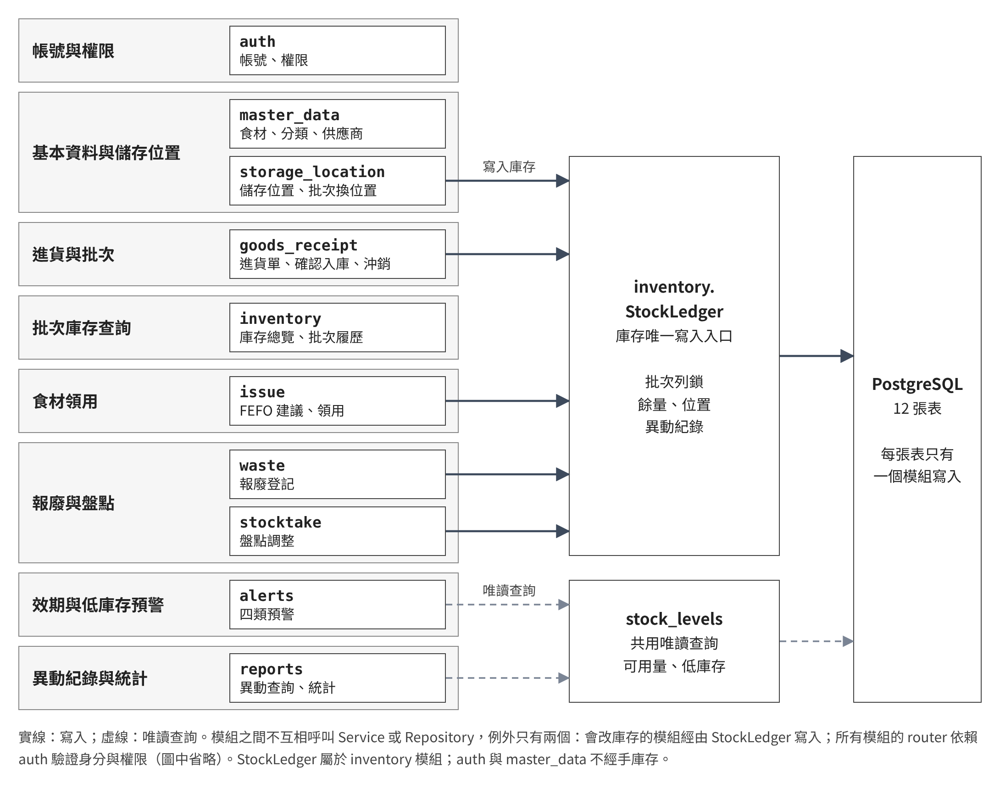

*圖 4　食序 FoodFlow 子系統切割圖*

#### （二）子系統與功能

| 八大功能 | 後端模組 | FR | 實作內容 |
| --- | --- | --- | --- |
| 帳號與權限管理 | `auth` | FR-01、FR-02 | 登入、登出、員工帳號管理 |
| 基本資料與儲存位置管理 | `master_data` | FR-03、FR-04 | 食材、食材分類、供應商維護 |
| （同上） | `storage_location` | FR-05 | 位置維護、位置摘要、批次換位置 |
| 進貨與批次管理 | `goods_receipt` | FR-06、FR-07 | 進貨草稿、確認入庫、進貨沖銷 |
| 批次庫存查詢 | `inventory` | FR-08、FR-09 | 庫存總覽、批次查詢與異動履歷 |
| 食材領用與消耗登記 | `issue` | FR-10、FR-11 | FEFO 建議、多批次領用、領用沖銷 |
| 效期與低庫存預警 | `alerts` | FR-12～FR-14 | 四類預警、建議動作、預警天數設定 |
| 報廢與盤點 | `waste` | FR-15 | 報廢登記與報廢紀錄 |
| （同上） | `stocktake` | FR-16 | 盤點預覽與確認調整 |
| 異動紀錄與統計 | `reports` | FR-17、FR-18 | 異動查詢、位置變更紀錄、期初期末統計、報廢分布 |

另有 `health` 模組提供 `GET /health` 健康檢查，掛在 `/api/v1` 主路由之外、不需登入，不屬於八大功能，也不寫入任何資料表。截至 2026 年 11 月 13 日（commit `244c4be`），八大功能的後端模組與前端頁面皆已實作。

#### （三）切割理由

- 每個功能的規則變動原因不同，分開後四人可以平行開發，互不修改彼此的檔案。
- 報廢與盤點雖然屬於同一功能，但流程與防重送方式不同，所以分成兩個模組；基本資料與儲存位置也因換位置流程牽涉庫存批次而分開。
- 多個模組都會改庫存，所以把庫存寫入集中到 `inventory.StockLedger`，避免規則重複。

#### （四）資料表寫入權

每張表**只有一個模組可以寫入**，讀取不受限。

| 資料表 | 寫入者 |
| --- | --- |
| `employee` | `auth` |
| `ingredient_category`、`ingredient`、`supplier` | `master_data` |
| `storage_location` | `storage_location` |
| `goods_receipt`、`goods_receipt_item` | `goods_receipt` |
| `inventory_batch`、`inventory_transaction`、`batch_location_change` | `inventory.StockLedger` |
| `waste_record` | `waste` |
| `alert_setting` | `alerts` |

`issue`、`stocktake` 沒有自己的資料表，數量變動全部經由 StockLedger 寫入 `inventory_batch` 與 `inventory_transaction`；`storage_location` 的批次換位置也經由 StockLedger 寫入 `batch_location_change`；`reports` 只讀取，不寫入任何資料表。

#### （五）模組間依賴

模組不可呼叫彼此的 Service 或 Repository，只有兩個例外：

- 會改庫存的模組（`goods_receipt`、`issue`、`waste`、`stocktake`、`storage_location`）依賴 `inventory.StockLedger`。
- 所有路由依賴 `auth` 提供的身分與權限檢查。

低庫存與可用量由共用的唯讀查詢 `db/queries/stock_levels` 及 `app/domain/` 的判定函式提供，首頁預警與庫存總覽的結果因此一致。

## 附錄

以下為交件 PDF 未收錄的補充設計。

### 附錄一、變更檢驗表

本表檢驗設計是否能把變更限制在小範圍內。路徑中的 `app/` 指 `backend/app/`，`tests/` 指 `backend/tests/`。

「已驗證」表示已逐項對照目前程式碼：表中列出的既有檔案都存在，「不用改」欄的類別確實沒有 import 或建立會被替換的具體實作。分層依賴另由 CI 的 import-linter 規則（`backend/pyproject.toml`）與 `tests/unit/test_architecture_rules.py` 持續檢查。

| 情境 | 新增 | 修改 | 不用改 | 驗證狀態 |
| --- | --- | --- | --- | --- |
| **C1 新增預警規則** | `app/modules/alerts/rules.py` 新增一個 `AlertRule` 子類別、對應單元測試 | `AlertRuleFactory.create()` 加入一行；`alerts/schemas.py` 的 `AlertStatus` 加一個值；`frontend/src/shared/ui/statusBadgeMap.ts`（顯示文字與顏色）；以 `npm run gen:api` 重新產生 `frontend/src/shared/api/schema.d.ts` | 既有四條規則、`AlertService`、`alerts/router.py`、`AlertNotifier` | 已驗證 |
| **C2 換挑批次規則** | `app/modules/issue/strategies/<new>_strategy.py`、`tests/unit/test_<new>_strategy.py` | `app/modules/issue/dependencies.py`（`DEFAULT_STRATEGY = FefoStrategy` 這一行換成新策略） | `IssueService`（只依賴 `BatchSelectionStrategy` 介面）、`ManualStrategy`、`issue/router.py`、`StockLedger`、Repository、前端 | 已驗證 |
| **C3 加外部通知** | `app/modules/alerts/notifier.py` 新增一個 `AlertNotifier` 實作（例如 Email）；排程進入點 `app/jobs/`；對應測試 | `app/core/config.py`、`.env.example`（通道設定）；`docker-compose.yml` 或系統排程（觸發 job）；`backend/pyproject.toml`（若需要新套件） | 所有 `AlertRule`、`AlertRuleFactory`、`InAppNotifier`、`AlertService`、`alerts/dependencies.py`、`alerts/router.py`、前端 | 介面已驗證；排程進入點為期末延伸 |
| **C4 換資料庫**（其他 SQL 資料庫） | `backend/alembic/versions/` 下新資料庫的 baseline migration | `docker-compose.yml`、`docker/initdb/01-create-test-db.sql`、`.env.example`、`backend/pyproject.toml`（目前 driver 為 `psycopg`）；`app/core/db.py`（連線與 `READ COMMITTED` 設定）；`backend/alembic/env.py`；`app/db/models/` 與 `app/db/queries/`（僅不相容的型別或語法）；`app/modules/*/repository_sqlalchemy.py`、`app/modules/inventory/ledger_sqlalchemy.py`（僅不相容的查詢）；`scripts/backup.sh`、`restore.sh` | 所有 `service.py`、`router.py`、`schemas.py`、Domain（`app/domain/`、`issue/strategies/`）、Repository 介面、`StockLedger` 介面、前端 | 已驗證 |
| **C5 測試跨日** | `tests/unit/`、`tests/integration/` 下的測試案例 | 無正式程式碼。單元測試注入 `FixedClock`（例如 `tests/unit/test_issue_service.py`）；API 測試用 `app.dependency_overrides[get_clock]`（例如 `tests/integration/test_auth_and_write.py`）；手動驗收在 `.env` 設定 `APP_FIXED_NOW` | `app/core/clock.py` 的 `SystemClock`、`app/core/dependencies.py` 的 `get_clock`、`service.py`、`router.py`、Domain、Repository | 已驗證 |

補充：

- **C1：** `AlertService` 只透過 `AlertRuleFactory` 取得規則並逐條呼叫 `evaluate()`，不認得具體規則類別。若新規則需要新資料，還要擴充載入快照的 Repository；若預警是新形狀，還要改 `alerts/schemas.py`。兩種情況既有規則都不用改。`statusBadgeMap.ts` 目前已有過期、今日到期、即期、低庫存、正常五種狀態。
- **C2：** `IssueService` 在鎖內用注入的預設策略重算 FEFO 基準，換策略後基準跟著改變，不用改 Service。換成非 FEFO 策略後，`is_non_fefo` 的實際意義變成「偏離系統建議」，欄位名稱、錯誤訊息與報表文字要另外決定是否調整。
- **C3：** 外部 Notifier 只由 job 使用，查詢預警仍使用 `InAppNotifier`，不會在查詢時發送外部通知。C3 需要新增排程進入點，屬於期末延伸，首版沒有。
- **C4：** 程式中沒有手寫 SQL 字串，也沒有 import PostgreSQL 方言，模型只用 SQLAlchemy 通用型別。唯一的例外是 `app/core/db.py` 的 `for_update(key_share=True)`（目前由 `storage_location` 鎖定位置時使用），它產生 PostgreSQL 的 `FOR NO KEY UPDATE`，換資料庫時要在 `for_update` 內改成新資料庫支援的鎖定方式，呼叫端不用改。換資料庫後要重跑 `tests/integration`，並確認隔離層級仍為 `READ COMMITTED`。`tests/unit/test_architecture_rules.py` 中檢查 constraint 名稱長度的測試以 PostgreSQL 的 63 字元為上限，換資料庫時要依新資料庫的限制調整。備份與還原腳本 `scripts/backup.sh`、`restore.sh`（NFR-06）使用 PostgreSQL 的 `pg_dump`／`pg_restore`，也要改寫。換成非 SQL 資料庫時，還要重寫所有 Repository 與 StockLedger 實作、`UnitOfWork` 及模型類別，也要重新評估列鎖機制。
- **C5：** `get_clock` 只在 `APP_ENV` 不是 `production` 時採用 `APP_FIXED_NOW`。「固定時鐘下可登入並完成一次寫入」已由 `tests/integration/test_auth_and_write.py` 涵蓋；以環境變數設定 `APP_FIXED_NOW` 的路徑由 `tests/unit/test_config_and_clock.py` 與 `tests/integration/test_seed_demo.py` 涵蓋。

### 附錄二、技術選型

| 部分 | 技術 | 理由 |
| --- | --- | --- |
| 前端框架 | React、TypeScript、Vite | 元件化適合多功能頁面；TypeScript 可在編譯時抓出前後端欄位不符 |
| UI | Mantine | 內建表單與表格元件，減少自刻介面的時間 |
| 資料請求 | TanStack Query | 統一快取與失效，領用後可讓預警與庫存畫面同步更新 |
| 路由 | React Router | 只處理頁面路由；伺服器資料一律交給 TanStack Query |
| 後端框架 | Python FastAPI | `Depends` 可實作建構子注入的組裝；自動產生 OpenAPI，可據此產生前端型別 |
| 資料存取 | SQLAlchemy 2、Alembic | 支援列鎖與交易；migration 讓四人的 schema 保持一致 |
| 資料驗證 | Pydantic | 可嚴格驗證數量格式，超過三位小數時明確拒絕 |
| 資料庫 | PostgreSQL（docker-compose） | 支援 `NUMERIC(12,3)` 與列鎖，能滿足併發領用不超領的需求；容器讓全組環境一致 |

開發環境版本見 `README.md`，所有套件版本見架構主幹的 Stack 章節。

### 附錄三、前端架構

前端是單頁應用（SPA），原始碼在 `frontend/src/`，依「全站組裝、功能、共用」分成三個資料夾。

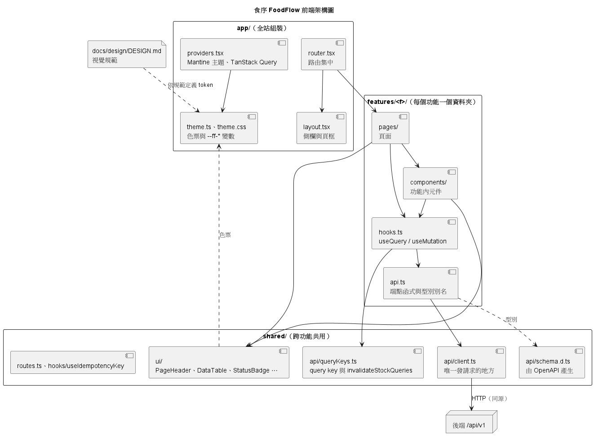

#### （一）資料夾結構

```text
frontend/src/
  main.tsx                 # 進入點
  app/                     # 全站組裝
    providers.tsx          # MantineProvider（套用主題）、QueryClientProvider
    router.tsx             # 所有路由集中在這裡
    layout.tsx             # 側欄導覽與頁框
    theme.ts、theme.css    # 色票、陰影、漸層與 --ff-* CSS 變數
  features/<f>/            # 每個功能一個資料夾，名稱與後端模組相同
    api.ts                 # 端點函式與型別別名
    hooks.ts               # 包裝成 useQuery／useMutation
    components/            # 只在這個功能使用的元件
    pages/                 # 頁面
  shared/
    api/                   # client.ts、queryKeys.ts、schema.d.ts
    ui/                    # 共用元件
    hooks/                 # useIdempotencyKey
    routes.ts              # 路徑常數與預警動作對應的路由
```

`features/` 下有 `auth`、`master_data`、`storage_location`、`goods_receipt`、`inventory`、`issue`、`alerts`、`waste`、`stocktake`、`reports` 與 `health`。

#### （二）資料存取分層：api.ts → hooks.ts → pages

| 層 | 位置 | 職責 | 不可以 |
| --- | --- | --- | --- |
| HTTP 用戶端 | `shared/api/client.ts` | 全專案唯一呼叫 `fetch` 的地方；以同源 cookie 送出請求；統一處理錯誤格式（轉成 `ApiError`）與 401（導回登入頁）；匯出 `API_PREFIX`（`/api/v1`）給各 `api.ts` 組路徑 | 知道個別功能的端點 |
| API 函式 | `features/<f>/api.ts` | 每個端點一個函式；型別取自 `shared/api/schema.d.ts`（由後端 OpenAPI 以 `npm run gen:api` 產生，不手寫） | 管快取、被元件直接 import、被其他 feature import |
| Hooks | `features/<f>/hooks.ts` | 以 TanStack Query 包成 `useQuery`／`useMutation`；query key 取自 `shared/api/queryKeys.ts`；會改庫存的 mutation 成功後呼叫 `invalidateStockQueries()`，讓儲存位置、庫存、預警、領用、報廢、盤點、統計畫面一起更新 | 自行計算到期狀態、低庫存或數量 |
| 頁面與元件 | `features/<f>/pages/`、`components/` | 版面、表單與互動；只透過 `hooks.ts` 取資料 | 直接發請求、import `api.ts` 或 `client.ts` |

跨 feature 要用別人的資料時，import 對方的 `hooks.ts`，例如報表、盤點與儲存位置頁面使用 `auth/hooks.ts` 的 `useCurrentEmployee` 判斷是否顯示管理者功能（權限仍由後端檢查）。這些規則由 `frontend/eslint.config.js` 的 `no-restricted-imports`、`no-restricted-globals` 在 `npm run lint` 與 CI 中檢查。

伺服器資料只放在 TanStack Query 快取，React Router 只處理頁面路由，不使用 `loader`／`action`。數量一律以字串傳遞，前端不做數量運算；到期狀態、剩餘天數、低庫存與是否非 FEFO 都以後端回傳為準。

#### （三）共用元件（`shared/ui/`）

各頁面先使用共用元件，畫面才會一致。每個檔案開頭都有用法註解。

| 元件 | 用途 |
| --- | --- |
| `PageHeader` | 每頁一個 h1，可加圖示；頁面唯一的主要按鈕放在 `actions` |
| `Toolbar`、`SearchInput` | 主卡片頂部的搜尋與篩選 |
| `DataTable` | 表格外框與表頭，列由呼叫端提供 |
| `EmptyState` | 空狀態提示 |
| `FormModal` | 表單與確認對話框，送出中不能關閉 |
| `StatusBadge`、`statusBadgeMap.ts` | 效期與庫存狀態標籤，同時顯示文字與顏色；狀態文字與色票只定義在 `statusBadgeMap.ts` |
| `Quantity` | 後端數量字串的顯示格式，只處理顯示，不做運算 |
| `ActiveBadge`、`CodeTag`、`StorageTypeIcon`、`icons.tsx` | 啟用狀態、代碼、保存方式圖示與線條圖示 |

`shared/hooks/useIdempotencyKey` 為領用與報廢表單產生 `Idempotency-Key`（見 5.6），每個表單實例一把，成功或內容變更後才更換。

#### （四）設計系統

視覺規範寫在 `docs/design/DESIGN.md`，包含色彩、字體、間距、圓角、元件樣式與觸控規則，與其他文件衝突時以它為準。程式中的實作是 `frontend/src/app/theme.ts`（Mantine 主題、色票與 `cssVariablesResolver`）與 `frontend/src/app/theme.css`。

- **顏色只從主題取：** 元件使用 Mantine 色票名稱（例如 `forest.8`、`expired.8`）或 `--ff-*` CSS 變數。色碼只能寫在 `app/theme.ts` 與 `app/*.css`，`src/features/**` 中寫死的色碼會被 ESLint 擋下。要新顏色時，先在主題加 token，再從元件引用。
- **狀態不能只靠顏色：** 效期與庫存狀態一律文字加顏色（NFR-01）。
- **觸控：** 可點擊目標至少 44px，操作不放在 hover 或 Tooltip 中；每個畫面最多一個主要按鈕。
- **驗收尺寸：** 1024×768 不出現橫向捲動；進貨、領用、報廢、預警四頁另外檢查 1366×768。
