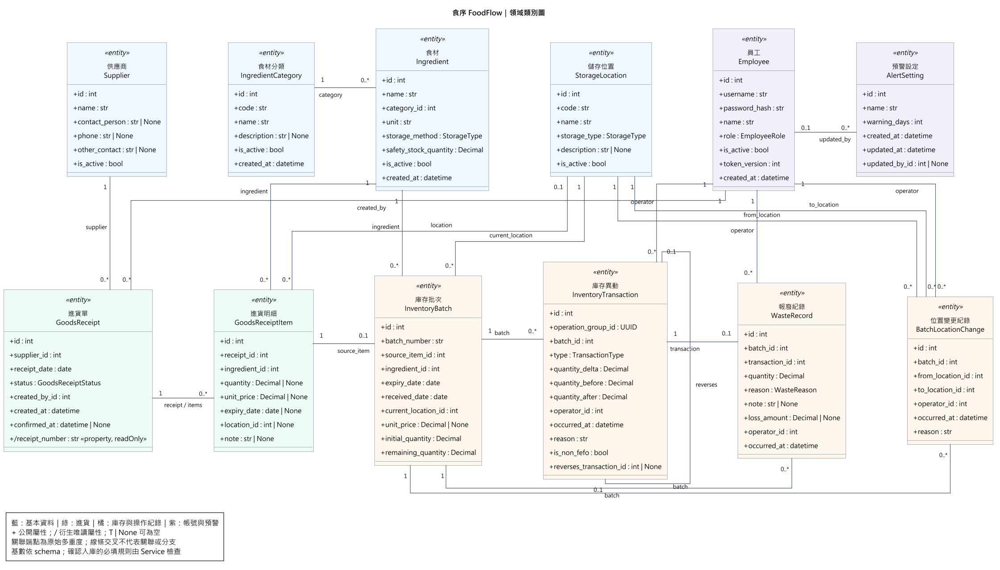

# 食序 FoodFlow：物件設計文件

第 17 組｜草稿｜2026-11-10

## 壹、系統簡介

### 一、系統簡介與特色

食序 FoodFlow 為餐飲食材庫存與效期預警系統，服務對象為單一門市、非連鎖的獨立餐廳，提供管理者與一般員工透過電腦或平板瀏覽器進行日常食材管理。系統整合帳號權限、基本資料與儲存位置、進貨與批次入庫、庫存查詢、食材領用、效期與低庫存預警、報廢與盤點，以及異動紀錄與統計等八大功能，協助餐廳集中掌握食材數量、保存期限、存放位置與使用情形。

本系統以庫存批次作為追蹤核心，分別記錄同一食材不同批次的來源、到期日、儲存位置、進貨單價與剩餘數量。領用時依「先到期先使用」（First Expired, First Out，FEFO）原則提供批次建議，並透過站內預警呈現過期、今日到期、即期及低庫存資訊，協助員工安排備料、補貨與報廢作業。

系統採用分層式架構，將介面呈現、商業規則與資料存取分離。涉及庫存變動的操作透過交易控制、資料鎖定與防重送機制，維持批次餘量及異動紀錄的一致性，並保留操作者、時間與來源，以支援後續查詢與追溯。系統目的在於改善人工紀錄分散與食材去向不易追查的問題，協助餐廳管理缺料及食材浪費風險。

### 二、軟體架構圖

本系統由前端客戶端、後端應用程式與資料儲存層構成，採用既有 C 文件的系統架構設計，如圖 1 所示。

#### （一）前端客戶端層

前端採用 React、TypeScript 與 Vite 建置，搭配 Mantine 元件呈現操作介面，提供登入、進貨登記、庫存查詢、領用及預警等功能。前端負責畫面呈現、表單輸入與操作回饋，透過共用 API 存取元件呼叫後端服務；庫存數量、效期狀態與權限判定則以後端處理結果為準。

#### （二）API 入口與安全控管

後端由 FastAPI 提供統一的 /api/v1 API 入口，透過 JWT 驗證使用者身分，並依管理者與一般員工角色限制操作權限。API 層負責請求格式驗證、登入檢查及權限控管，將合法請求交由業務服務處理，並以一致格式回傳結果與錯誤訊息。

#### （三）後端應用層

後端採用 Controller、Service 與 Repository 分層架構，以區分各項職責。

1. Controller 層：由 API 路由及資料驗證模型組成，負責接收請求、驗證輸入與存取權限，以及呼叫對應的 Service。

2. Service 層：負責確認入庫、進貨沖銷、FEFO 領用、報廢與盤點調整等商業規則，並協調交易範圍、領域規則及資料存取作業。

3. Repository 層：提供資料查詢與儲存介面，透過 SQLAlchemy 實作資料庫操作，降低商業邏輯對資料存取細節的依賴。

#### （四）領域規則與庫存一致性

領域規則包含批次選擇策略、效期分類與低庫存判定，供各功能模組共用。庫存寫入則統一透過 StockLedger 處理批次餘量、位置及異動紀錄，配合交易與列鎖，避免多位員工同時操作造成資料不一致。

預警於查詢時依目前庫存與日期計算，透過 API 回傳至首頁顯示。日期判定採用可注入的 Clock，依臺灣時區處理，並支援測試時固定日期。

#### （五）資料儲存層

系統採用 PostgreSQL 17 儲存員工、食材、供應商、進貨單、庫存批次與各類操作紀錄等資料。資料表透過主鍵、外鍵、唯一限制及其他完整性約束維護資料關聯；Service 統一控制交易，使同一筆作業所涉及的庫存與紀錄全部成功寫入，或於失敗時一併回滾。

## 貳、物件設計

本章依 SRS v3.0、既有 B 文件領域模型及 C 文件分層架構，說明八大功能模組的物件職責與協作方式。已存在的服務以目前程式名稱說明；領用策略、預警規則與其他模組的完整服務依 C 文件設計描述，不代表所有功能均已實作或完成驗收。

### 一、帳號與權限管理模組

帳號與權限管理模組對應 FR-01、FR-02，以 Employee 作為使用者身分與角色資料的核心物件，保存帳號、密碼雜湊、姓名、角色、啟用狀態與 token_version。系統角色分為管理者與一般員工，登入後依角色開放可執行的作業。

Controller 接收登入、登出與帳號維護請求，由 AuthService 執行密碼驗證、帳號啟用檢查、管理者資格及帳號異動規則，再透過 AuthRepository 存取資料。JWT 經 Cookie 傳遞，身分驗證同時檢查簽章、有效時間、員工狀態與 token_version；登出及密碼重設後可使既有憑證失效。各功能路由共用 get_current_employee 與 require_admin，維持一致的存取控制。

### 二、基本資料與儲存位置管理模組

本模組對應 FR-03～FR-05，以 IngredientCategory、Ingredient、Supplier 與 StorageLocation 管理食材分類、食材品項、供應商及實際存放位置。Ingredient 與分類關聯，記錄單位、保存方式及安全庫存量；StorageLocation 獨立記錄儲存位置，避免將保存方式與實際位置混為同一資料。

基本資料維護由管理者執行，一般員工可查詢。StorageLocationService 透過 Repository 處理位置資料及代碼唯一性檢查；整批換位置由 BatchRelocationService 驗證目標位置、鎖定批次，並呼叫 StockLedger.move 更新位置及建立 BatchLocationChange。位置變更紀錄分別連結原位置與新位置，保留操作者、時間與原因，不產生數量異動，也不改變該批次剩餘量。

### 三、進貨與批次入庫管理模組

本模組對應 FR-06、FR-07，以 GoodsReceipt 表示一次向同一供應商收貨的單據，GoodsReceiptItem 表示各筆到貨明細。單頭關聯供應商與建立員工，明細關聯食材及預定入庫位置，保存數量、單價、到期日與備註；進貨單號由識別碼衍生顯示。

GoodsReceiptService 協調草稿建立、修改、刪除、查詢、確認入庫及管理者沖銷。草稿可暫存未填完整的明細，確認入庫時則檢查必填資料、數量、到期日與有效的關聯資料。系統在同一交易內鎖定單頭，透過 StockLedger.receive 為每筆明細建立對應的 InventoryBatch 與進貨異動；source_item_id 的唯一限制防止同一明細重複建立批次。已確認單據不直接編輯，重送確認不得重複入庫；沖銷僅限符合規則且沒有後續數量異動的完整進貨批次，並以反向異動保留歷史，不刪除原進貨紀錄。

### 四、批次庫存查詢模組

本模組對應 FR-08、FR-09，以 InventoryBatch 作為庫存追蹤單位，關聯來源進貨明細、食材與目前儲存位置，保存批號、到期日、進貨日期、單價、初始量及剩餘量。InventoryService 透過 InventoryRepository 提供食材庫存總覽、批次清單、批次詳細資訊、數量異動及位置變更歷程等唯讀查詢。

系統分別呈現實體庫存量與可用庫存量：前者包含尚未報廢的過期量，後者僅計入未過期批次的剩餘量。效期分類使用共用日期規則，避免庫存總覽與預警頁判定不一致。查詢結果支援篩選與分頁，並保留歷史資料的可追溯性；查詢服務不直接修改批次餘量或位置。

### 五、食材領用與消耗登記模組

本模組對應 FR-10、FR-11，以 InventoryBatch 為領用來源，透過 InventoryTransaction 記錄各批次的扣庫存結果。依 C 文件設計，BatchSelectionStrategy 抽象化挑選規則，由 FefoStrategy 提供先到期先使用建議，ManualStrategy 處理人工指定批次。可用批次依到期日、進貨日期及批號排序，最早到期批次不足時再分配下一批。

員工確認實際領用量後，Service 檢查數量大於零、批次尚未過期且提交當下餘量足夠，再透過 StockLedger 扣庫存並建立各批次異動。人工選擇偏離 FEFO 建議時須填原因，並在異動標記 is_non_fefo。多批次領用置於同一交易，搭配批次列鎖與防重送設計，確保全部成功或全部不生效，不因併發造成超領。

### 六、效期與低庫存預警模組

本模組對應 FR-12～FR-14，以 AlertSetting 保存全店預警天數及設定更新資訊，並結合 Ingredient 的安全庫存量與 InventoryBatch 的到期日、剩餘量計算提醒。依 C 文件設計，AlertRule 與 AlertRuleFactory 組合過期、今日到期、即期及低庫存規則，提供一致的預警結果。

效期以到期日與 Clock 提供的當日日期比較，過期、今日到期與即期狀態互斥，今日到期仍可領用；過期不自動扣庫存。低庫存依可用量小於或等於安全庫存量判定，安全庫存量為零時不產生低庫存提醒。已用完的批次不再列為待處理預警。InAppNotifier 的設計以 API 回應提供站內顯示，查詢與操作成功後重新取得最新結果；首版不設 Email、簡訊或背景推播。

### 七、報廢與盤點管理模組

本模組對應 FR-15、FR-16。報廢以 WasteRecord 保存批次、數量、原因、備註、損失金額、操作者及時間，並透過唯一的 transaction_id 對應一筆 WASTE 類型的 InventoryTransaction。Service 檢查報廢量大於零且不超過餘量，透過 StockLedger.deduct 扣庫存，與報廢紀錄於同一交易內完成。損失金額依批次單價計算；單價未知時保留未知，不當作零元。

盤點由管理者輸入實際量與原因，預覽帳面量及差額，確認時鎖定批次並核對預覽時的帳面量；若已被其他作業變更則拒絕舊確認，要求重新核對。調整由 StockLedger.adjust 記錄差額與前後量，無差額時不新增數量異動。依既有模型，盤點以 InventoryTransaction 保存紀錄，不另新增盤點資料表。

### 八、異動紀錄與統計模組

本模組對應 FR-17、FR-18，以 InventoryTransaction、WasteRecord 與 BatchLocationChange 作為歷程及統計來源，提供依日期、食材、批次、類型與操作者查詢。InventoryTransaction 保存增減量、前後量、操作者、時間、原因與非 FEFO 標記，operation_group_id 可辨識同一次跨批次操作；reverses_transaction_id 自我關聯連回被沖銷的原異動。歷史異動不可任意修改或刪除，位置變更則與數量異動分開呈現。

統計依實際異動時間計算期初量、淨進貨量、淨領用量、淨報廢量、調整淨額及期末量，沖銷歸入對應項目，避免重複計數。一般員工可查看異動及期初期末統計；報廢分布與損失金額僅供管理者查閱。不同食材單位分別統計，未知單價的報廢另行標示，不以零元掩蓋。

### 九、八大模組整體設計

八大模組以共用領域物件連接營運流程：Employee 識別操作者；食材、分類、供應商與位置提供作業基礎；GoodsReceipt 與 GoodsReceiptItem 保存到貨來源，確認後形成 InventoryBatch；領用、報廢、盤點與沖銷透過 StockLedger 留下 InventoryTransaction；整批換位置則留下 BatchLocationChange。預警及統計讀取相同的批次與歷程資料，使畫面與追蹤結果具有一致的資料來源。

| 功能模組 | 核心領域物件 | 設計職責 |
| --- | --- | --- |
| 帳號與權限 | Employee | 識別操作人員、角色與帳號狀態。 |
| 基本資料與儲存位置 | IngredientCategory、Ingredient、Supplier、StorageLocation | 維護作業基礎資料及位置。 |
| 進貨與批次入庫 | GoodsReceipt、GoodsReceiptItem、InventoryBatch | 保存到貨來源、確認入庫與進貨沖銷。 |
| 批次庫存查詢 | Ingredient、InventoryBatch | 查詢總量、效期、位置及批次歷程。 |
| 食材領用與消耗 | InventoryBatch、InventoryTransaction | FEFO 建議、領用驗證與扣庫存。 |
| 效期與低庫存預警 | AlertSetting、Ingredient、InventoryBatch | 即時計算效期及低庫存提醒。 |
| 報廢與盤點 | WasteRecord、InventoryBatch、InventoryTransaction | 記錄損耗與盤點差額。 |
| 異動紀錄與統計 | InventoryTransaction、WasteRecord、BatchLocationChange | 追蹤數量與位置歷程、彙整統計。 |

上述物件跨模組共用，不表示同一資料由多個模組任意寫入。一般資料由對應模組維護，批次餘量、目前位置及異動紀錄統一經 StockLedger 更新；各模組不得自行新增另一套庫存扣減邏輯。

#### （一）共用物件與相依關係

| 物件或介面 | 職責與協作方式 |
| --- | --- |
| StockLedger／SqlAlchemyStockLedger | 集中庫存鎖定、入庫、扣減、調整、沖銷與位置變更；只處理資料寫入，交易邊界由 Service 管理。 |
| UnitOfWork／SqlAlchemyUnitOfWork | 由 Service 定義同一筆業務交易，成功時提交、失敗時回滾，避免部分資料成功寫入。 |
| Clock／SystemClock／FixedClock | 統一提供時間及臺灣時區日期，正式與測試環境可替換。 |
| StockOp | 傳遞操作群組、操作者、發生時間及原因，使相關異動保有一致的操作脈絡。 |
| Repository 介面與 SQLAlchemy 實作 | Service 依賴資料存取介面；具體實作在相依組裝處注入，隔離查詢細節。 |

SQLAlchemy 模型同時作為領域實體，Service 不直接操作 SQLAlchemy Session；可替換的策略與規則依既有架構設計使用純資料物件。模組間不直接呼叫彼此的 Service 或 Repository，庫存寫入及共用身分驗證依既定例外規則協作。

#### （二）完整領域物件關聯

圖 2 沿用 B 文件正式領域類別圖，呈現 12 個核心實體及其關聯，作為本章物件協作說明的共同依據。圖中的實體屬性與關聯保持原樣；本次不變更類別圖、資料庫 Schema 或程式。

#### （三）文件依據與範圍

編製依據：docs/srs.md（SRS v3.0）、docs/c-software-design.md、docs/diagrams/b-class-diagram.puml，以及目前帳號、儲存位置、進貨、庫存查詢、StockLedger、UnitOfWork 與 Clock 的原始碼。章節安排參考第 2 組「D－物件設計文件」範例，業務內容以 FoodFlow 文件為準。

本文件為第 17 組物件設計文件草稿，涵蓋「壹、系統簡介」與「貳、物件設計」，供後續校對與排版使用；其他模組的設計規劃應於整合完成後再與實作核對。
